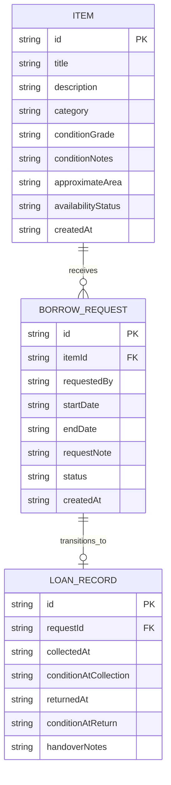

# BorrowNest — System Architecture

## 1. Architectural Philosophy

BorrowNest is designed around three architectural pillars:
1. **Local-First & Client-Centric**: The user's device is the primary source of truth. All operations, records, and state transitions occur client-side without relying on an ongoing server connection.
2. **Component Modularity & Separation of Concerns**: Presentational components, interaction state, storage adapters, and domain validation are isolated to preserve long-term maintainability.
3. **Genuine Data Integrity**: The architecture deliberately rejects synthetic mock generators, third-party analytics trackers, and fake populated fixtures in production code.

---

## 2. Technology Stack Selection

- **UI Framework**: React 19 (Functional components, React Hooks).
- **Build System & Dev Server**: Vite 8 (Fast ESM-based dev server, optimized Rollup bundling).
- **Styling Architecture**:
  - Global CSS tokens (`src/styles/tokens.css`): Centralizes brand palette, spacing scale, font stacks, radii, and elevations.
  - Reset & Baseline (`src/styles/global.css`): Box sizing, standard typographic hierarchy, focus rings, accessibility utilities.
  - Scoped CSS Modules (`*.module.css`): Encapsulates component styles without global class pollution or runtime CSS-in-JS overhead.
- **Testing Framework**: Vitest 5 with React Testing Library and JSDOM.
- **Static Code Analysis**: ESLint 10 (Flat Config) with React and React Hooks plugins.
- **CI / CD Pipeline**: Official GitHub Actions runner (`.github/workflows/ci.yml`).

---

## 3. Repository Structure

```text
BorrowNest/
├── .github/
│   └── workflows/
│       └── ci.yml               # GitHub Actions CI workflow (lint, test, build)
├── docs/                        # Architectural and governance documentation
│   ├── design-rationale/        # Formal QOC decisions and blueprints (Module 02)
│   │   ├── README.md
│   │   ├── QOC_METHOD_AND_SCORING.md
│   │   ├── DR-01_ITEM_DISCOVERY.md
│   │   ├── DR-02_BORROWING_APPROVAL.md
│   │   ├── DR-03_AVAILABILITY_SCHEDULING.md
│   │   ├── DR-04_CONDITION_HANDOVER.md
│   │   ├── DR-05_LOCATION_PRIVACY.md
│   │   ├── DR-06_RESPONSIVE_NAVIGATION.md
│   │   ├── DECISION_LOG.md
│   │   ├── EVIDENCE_REGISTER.md
│   │   ├── TRACEABILITY_MATRIX.md
│   │   ├── SELECTED_DESIGN_BLUEPRINT.md
│   │   └── TECHNICAL_RISK_REGISTER.md
│   ├── ARCHITECTURE.md
│   ├── ASSET_POLICY.md
│   ├── DESIGN_DECISION_AREAS.md
│   ├── PRIVACY_AND_DATA_POLICY.md
│   ├── PRODUCT_OVERVIEW.md
│   ├── PRODUCT_REQUIREMENTS.md
│   └── PRODUCT_SCOPE.md
├── public/                      # Static web assets
│   ├── borrownest-logo.svg      # Original brand vector asset
│   └── favicon.svg              # Browser tab icon
├── src/                         # Application source code
│   ├── components/              # Shared Presentational Components
│   │   ├── BrandMark.jsx        # SVG brand mark & wordmark
│   │   ├── BrandMark.module.css
│   │   ├── EmptyState.jsx       # Honest zero-state presentation
│   │   ├── EmptyState.module.css
│   │   ├── Footer.jsx           # Application footer
│   │   ├── Footer.module.css
│   │   ├── Header.jsx           # Responsive application header
│   │   └── Header.module.css
│   ├── features/                # Domain Feature Slices
│   │   ├── account/             # Account & Local Storage Management
│   │   │   └── pages/
│   │   │       ├── AccountPage.jsx
│   │   │       └── AccountPage.module.css
│   │   ├── borrowing/           # Borrowing Requests (Module 05 Roadmap)
│   │   │   └── BorrowingPlaceholder.jsx
│   │   ├── discover/            # Item Catalog & Discovery (Module 04 Roadmap)
│   │   │   ├── DiscoverPlaceholder.jsx
│   │   │   └── Placeholder.module.css
│   │   └── listings/            # Genuine Item Management (Module 03 Implemented)
│   │       ├── components/
│   │       │   ├── DeleteConfirmDialog.jsx
│   │       │   ├── DeleteConfirmDialog.module.css
│   │       │   ├── ListingCard.jsx
│   │       │   ├── ListingCard.module.css
│   │       │   ├── ListingDetailModal.jsx
│   │       │   ├── ListingDetailModal.module.css
│   │       │   ├── ListingForm.jsx
│   │       │   └── ListingForm.module.css
│   │       ├── hooks/
│   │       │   └── useListings.js
│   │       ├── pages/
│   │       │   ├── LendingPage.jsx
│   │       │   ├── LendingPage.module.css
│   │       │   └── LendingPage.test.jsx
│   │       ├── services/
│   │       │   ├── processItemImage.js
│   │       │   └── processItemImage.test.js
│   │       └── validation/
│   │           ├── itemValidation.js
│   │           └── itemValidation.test.js
│   ├── navigation/              # Responsive Navigation Subsystem (DR-06)
│   │   ├── Navbar.jsx
│   │   ├── Navbar.module.css
│   │   ├── navigationConstants.js
│   │   └── navigation.test.jsx
│   ├── services/                # Cross-Cutting Infrastructure Services
│   │   ├── backup/              # Local JSON Export & Validated Restore
│   │   │   ├── backupSchema.js
│   │   │   ├── exportBackup.js
│   │   │   ├── importBackup.js
│   │   │   └── backup.test.js
│   │   └── storage/             # Abstract & Concrete Storage Layer
│   │       ├── database.js
│   │       ├── IndexedDbStorageAdapter.js
│   │       ├── IndexedDbStorageAdapter.test.js
│   │       ├── StorageAdapter.js
│   │       └── storageErrors.js
│   ├── styles/                  # Global CSS foundations
│   │   ├── global.css           # Typography, reset, and a11y utilities
│   │   └── tokens.css           # Custom properties design system
│   ├── test/                    # Test configuration and setup
│   │   └── setup.js             # Fake-IndexedDB and canvas mock setup
│   ├── App.jsx                  # Root application shell & hash router
│   ├── App.module.css
│   ├── App.test.jsx             # Shell verification test suite
│   └── main.jsx                 # Client entry point
├── .editorconfig                # Universal indentation and whitespace rules
├── .gitignore                   # Repository exclusion patterns
├── eslint.config.js             # Flat ESLint rules configuration
├── index.html                   # HTML document root
├── LICENSE                      # MIT Open-Source License
├── package.json                 # Project dependencies and script declarations
├── README.md                    # Project documentation entry point
└── vite.config.js               # Vite and Vitest configuration
```

---

## 4. Conceptual Data Entities

While Module 01 establishes the foundational shell, the data architecture anticipates four core domain models for subsequent modules:



### Key Entity Descriptions:
1. **Item**: Represents a tangible good offered for lending. Stores public metadata (title, category, condition) and coarse neighborhood locality (per DR-05; exact street addresses are deliberately not stored).
2. **BorrowRequest**: Encapsulates a proposed loan period, borrower identification, and current decision status (`PENDING`, `APPROVED`, `DECLINED`, `CANCELLED`).
3. **LoanRecord**: Tracks the physical lifecycle of an approved loan, capturing timestamped collection, condition verification, return timestamp, and closing notes.

---

## 5. State Management & Local-First Strategy

- **Module 01 Baseline**: Lightweight React local state and semantic components.
- **Module 03 Persistence Architecture**:
  - **Decoupled Storage Layer**: Storage operations are strictly abstracted behind `StorageAdapter`, an abstract interface defining transactional CRUD, archiving, restoration, counting, and bulk batch operations.
  - **Native IndexedDB Adapter**: `IndexedDbStorageAdapter` provides the production browser persistence engine using the native `BorrowNest` database (schema version 1) and `items` object store. It utilizes secondary indexes on `status`, `category`, `createdAt`, and `updatedAt`. All write operations commit deterministically on transaction completion (`tx.oncomplete`), ensuring ACID durability.
  - **Custom Reactive Hook**: `useListings` encapsulates reactive item state, lifecycle mutations, loading and error states, and live stats computation without component-level storage coupling.
  - **Privacy-Preserving Media Pipeline**: `processItemImage` sanitizes owner-uploaded photographs client-side. Using an in-memory HTML5 Canvas, raw image pixels are re-encoded into clean WebP/JPEG Blobs (bounded to 1600px and 2.5MB), completely stripping EXIF metadata, camera serial numbers, and embedded GPS coordinates before persistence.
  - **Data Portability & Backup Subsystem**: `exportBackup` and `importBackup` enable client-side JSON serialization (`borrownest-backup` format v1) with base64 photo rehydration, schema validation, and both non-destructive merge and clean replace restore strategies.

---

## 6. Technical Constraints & Trade-offs

1. **Client-Side Storage Volatility**: Local browser storage can be cleared by user action. Mitigation: Module 03 implements single-click JSON export/backup and validated restore via the Account page.
2. **Absence of Remote Multi-User Network**: In the current local-first prototype, all actions happen on the local machine. We do not simulate fake remote networks; instead, the UI clearly delineates between the Lender perspective and the Borrower perspective.
3. **Asset Storage Size**: Local storage has memory quotas (typically several GB for `IndexedDB`). Mitigation: user-uploaded photographs are resized to a maximum dimension of 1600px and re-compressed to WebP/JPEG Blobs under 2.5MB client-side.
4. **Coarse Location Boundary**: In accordance with DR-05, listings require broad neighborhood tags and feature real-time heuristic pattern detection warning users against entering specific street addresses or gate codes.
