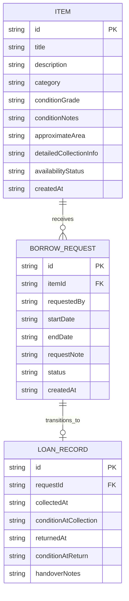

# BorrowNest — System Architecture

## 1. Architectural Philosophy

BorrowNest is designed around three architectural pillars:
1. **Local-First & Client-Centric**: The user's device is the primary source of truth. All operations, records, and state transitions occur client-side without relying on an ongoing server connection.
2. **Component Modularity & Separation of Concerns**: Presentational components, interaction state, storage adapters, and domain validation are isolated to preserve long-term maintainability.
3. **Genuine Data Integrity**: The architecture deliberately rejects synthetic mock generators, third-party analytics trackers, and fake populated fixtures in production code.

---

## 2. Technology Stack Selection

- **UI Framework**: React 19 (Functional components, React Hooks).
- **Build System & Dev Server**: Vite 8 (Fast ESM-based dev server, optimized Rollup bundling).
- **Styling Architecture**:
  - Global CSS tokens (`src/styles/tokens.css`): Centralizes brand palette, spacing scale, font stacks, radii, and elevations.
  - Reset & Baseline (`src/styles/global.css`): Box sizing, standard typographic hierarchy, focus rings, accessibility utilities.
  - Scoped CSS Modules (`*.module.css`): Encapsulates component styles without global class pollution or runtime CSS-in-JS overhead.
- **Testing Framework**: Vitest 5 with React Testing Library and JSDOM.
- **Static Code Analysis**: ESLint 10 (Flat Config) with React and React Hooks plugins.
- **CI / CD Pipeline**: Official GitHub Actions runner (`.github/workflows/ci.yml`).

---

## 3. Repository Structure

```text
BorrowNest/
├── .github/
│   └── workflows/
│       └── ci.yml               # GitHub Actions CI workflow (lint, test, build)
├── docs/                        # Architectural and governance documentation
│   ├── ARCHITECTURE.md
│   ├── ASSET_POLICY.md
│   ├── DESIGN_DECISION_AREAS.md
│   ├── PRIVACY_AND_DATA_POLICY.md
│   ├── PRODUCT_OVERVIEW.md
│   ├── PRODUCT_REQUIREMENTS.md
│   └── PRODUCT_SCOPE.md
├── public/                      # Static web assets
│   ├── borrownest-logo.svg      # Original brand vector asset
│   └── favicon.svg              # Browser tab icon
├── src/                         # Application source code
│   ├── components/              # Modular React UI components
│   │   ├── BrandMark.jsx        # SVG brand mark & wordmark
│   │   ├── BrandMark.module.css
│   │   ├── EmptyState.jsx       # Honest zero-state presentation
│   │   ├── EmptyState.module.css
│   │   ├── Footer.jsx           # Application footer
│   │   ├── Footer.module.css
│   │   ├── Header.jsx           # Responsive application header
│   │   └── Header.module.css
│   ├── styles/                  # Global CSS foundations
│   │   ├── global.css           # Typography, reset, and a11y utilities
│   │   └── tokens.css           # Custom properties design system
│   ├── test/                    # Test configuration and setup
│   │   └── setup.js             # Jest-DOM matcher extensions
│   ├── App.jsx                  # Root application shell
│   ├── App.module.css
│   ├── App.test.jsx             # Shell verification test suite
│   └── main.jsx                 # Client entry point
├── .editorconfig                # Universal indentation and whitespace rules
├── .gitignore                   # Repository exclusion patterns
├── eslint.config.js             # Flat ESLint rules configuration
├── index.html                   # HTML document root
├── LICENSE                      # MIT Open-Source License
├── package.json                 # Project dependencies and script declarations
├── README.md                    # Project documentation entry point
└── vite.config.js               # Vite and Vitest configuration
```

---

## 4. Conceptual Data Entities

While Module 01 establishes the foundational shell, the data architecture anticipates four core domain models for subsequent modules:



### Key Entity Descriptions:
1. **Item**: Represents a tangible good offered for lending. Stores public metadata (title, category, condition) and private collection instructions.
2. **BorrowRequest**: Encapsulates a proposed loan period, borrower identification, and current decision status (`PENDING`, `APPROVED`, `DECLINED`, `CANCELLED`).
3. **LoanRecord**: Tracks the physical lifecycle of an approved loan, capturing timestamped collection, condition verification, return timestamp, and closing notes.

---

## 5. State Management & Local-First Strategy

- **Module 01 Baseline**: Lightweight React local state and semantic components.
- **Module 03+ State Management**: Local-first persistence layer using browser `localStorage` and `IndexedDB`.
- **Decoupled Storage Layer**: Storage operations will be encapsulated behind an abstraction adapter interface (`StorageAdapter`), allowing future swap-out to encrypted local storage or peer-to-peer sync without modifying component business logic.

---

## 6. Technical Constraints & Trade-offs

1. **Client-Side Storage Volatility**: Local browser storage can be cleared by user action. Mitigation: subsequent modules will provide a single-click JSON export/backup feature.
2. **Absence of Remote Multi-User Network**: In the current local-first prototype, all actions happen on the local machine. We do not simulate fake remote networks; instead, the UI clearly delineates between the Lender perspective and the Borrower perspective.
3. **Asset Storage Size**: Local storage has memory quotas (typically 5MB for `localStorage`, several GB for `IndexedDB`). Mitigation: user-uploaded photographs will be resized and compressed on the client before being persisted.
