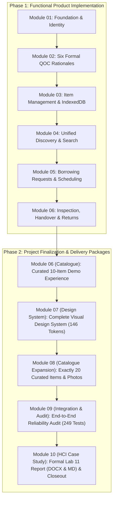

# BorrowNest — Final Project Completion Report
## Complete Architectural, Engineering, and Academic Closeout (Modules 01–10)

| Metadata | Details |
| :--- | :--- |
| **Product Name** | BorrowNest — Share what you own. Borrow what you need. |
| **Academic Context** | Riphah International University • Faculty of Computing • Class BSCS 5-1 |
| **Course** | SE2613: Human-Computer Interaction (HCI) • Fall 2026 |
| **Student Name & SAP** | Muhammad Taimoor Ajmal (SAP ID: 63461) |
| **Instructor / Supervisor** | Mr. Muhammad Shabbir Hassan |
| **Repository** | [https://github.com/muhammadtaimoorajmal/BorrowNest](https://github.com/muhammadtaimoorajmal/BorrowNest) |
| **Live Application** | [https://muhammadtaimoorajmal.github.io/BorrowNest/](https://muhammadtaimoorajmal.github.io/BorrowNest/) |
| **Official Release** | `v0.1.0` |
| **Final Test Metric** | **249 automated unit & integration tests passing across 31 test suites** |
| **Completion Date** | November 19, 2026 |

---

## 1. Executive Summary

This document marks the formal completion of the **BorrowNest** project. BorrowNest is an open-source, local-first web application engineered to facilitate peer-to-peer equipment and household goods sharing within residential communities. 

The project has successfully bridged advanced software engineering with rigorous Human-Computer Interaction (HCI) methodologies. Across a disciplined ten-stage development arc, the project delivered:
1. A complete, accessible, and reactive web application adhering to local-first client architecture.
2. Six authoritative Question-Option-Criteria (QOC) design rationale evaluations grounded in published HCI literature.
3. A curated, authentic demonstration catalogue of exactly 20 products with genuine local photography.
4. A tokenized design system of 146 CSS variables ensuring strict contrast and 44×44px mobile touch targets.
5. An automated quality gate harness containing 249 tests across 31 test suites with zero failures.
6. A frontend-only interactive Classroom Demonstration Marketplace featuring 5 simulated identities, single-browser role switching, catalogue seeder, and safe transaction reset.
7. A formal academic laboratory report delivered in both Markdown and professionally formatted Microsoft Word (`.docx`) formats.

---

## 2. Project Architecture & Development Arc

The BorrowNest development lifecycle was structured into two complementary phases:
- **Core Functional Implementation (Modules 01–06)**: Established the application foundations, architectural design rationale, data persistence, discovery engine, borrowing request workflows, and physical handover inspection protocols.
- **Project Finalization & Delivery Packages (Modules 06–10)**: Hardened visual presentation, expanded the product catalogue to exactly 20 authentic items, conducted comprehensive end-to-end integration audits, and compiled the formal academic case study.

---

## 3. Detailed Module Breakdown

### 3.1 Phase 1: Core Functional Product Implementation

#### Module 01: Project Foundation & Architecture
- **Objective**: Establish the technical foundations, repository configuration, design tokens, responsive application shell, and automated CI pipelines.
- **Key Deliverables**: React 19 + Vite 8 setup, initial CSS tokens, Vitest unit testing harness, GitHub Actions CI workflow, and foundational product architecture documentation.

#### Module 02: Architectural Decision Records (DR-01 through DR-06)
- **Objective**: Conduct formal Design Space Analysis using the Question-Option-Criteria (QOC) framework (MacLean et al., 1991) to evaluate trade-offs before implementation.
- **Key Deliverables**: Authored `DR-01` through `DR-06`, established quantitative 5-point rating formulation with normalized 100% criteria weights, published authoritative evidence register (E-01 through E-05), and formulated technical risk register.

#### Module 03: Item Management & Native Local Persistence
- **Objective**: Implement genuine item CRUD, responsive 4-section navigation shell, native IndexedDB persistence, and client-side photo processing.
- **Key Deliverables**: `StorageAdapter` and `IndexedDbStorageAdapter` (`borrowNestDB` Schema Version 1), client-side Canvas EXIF GPS stripping and 1600px downscaling, and JSON backup export/restore with storage quota diagnostics.

#### Module 04: Item Discovery, Category Browsing & Filtering
- **Objective**: Implement unified discovery (DR-01) allowing concurrent keyword searching and category exploration.
- **Key Deliverables**: `DiscoverPage.jsx`, accessible `ItemFilterBar.jsx` with category pills (`aria-pressed`), availability toggle, `aria-live="polite"` result counter, active filter chips with reset button, and detail modal inspection.

#### Module 05: Structured Borrowing Requests & Date Scheduling
- **Objective**: Implement explicit owner approval workflows (DR-02) and inclusive date-range scheduling with collision prevention (DR-03).
- **Key Deliverables**: `BorrowModal.jsx`, deterministic request state machine (`PENDING` $\rightarrow$ `APPROVED` | `DECLINED` | `CANCELLED`), inclusive interval intersection rule ($\text{candidateStart} \le \text{existingReturn} \land \text{candidateReturn} \ge \text{existingStart}$), dual-perspective workspace (*Borrowing* and *Lending*), and IndexedDB Schema Version 2.

#### Module 06: Physical Handover, Return Verification & Condition Inspection
- **Objective**: Implement physical equipment custody tracking and structured condition checkpoints (DR-04).
- **Key Deliverables**: Decoupled custody state machine (`RESERVED` $\rightarrow$ `ACTIVE` $\rightarrow$ `COMPLETED` or `RELEASED_NOT_COLLECTED`), standardized 5-tier condition scale (Like New, Good, Fair, Poor, Not Functional), collection and return handover modals with genuine photo attachment, side-by-side 3-column condition comparison card, uncollected reservation release workflow, and IndexedDB Schema Version 3 across three object stores (`items`, `borrowingRequests`, `loans`).

---

### 3.2 Phase 2: Finalization & Delivery Packages

#### Module 06 (Catalogue Delivery): Curated Demonstration Catalogue
- **Objective**: Provide first-time visitors with an authentic, immediate catalogue experience without injecting synthetic data into private IndexedDB stores.
- **Key Deliverables**: 10 initial curated demonstration products across 5 categories, local photography assets, attribution registry, and clear visual differentiation between example demonstration items and private user listings.

#### Module 07 (Design System Delivery): Visual Design System & CSS Architecture
- **Objective**: Transform prototype aesthetics into a cohesive, production-grade visual design system.
- **Key Deliverables**: 146 global CSS custom properties defined in `src/styles/tokens.css`, systematic audit script `validate-tokens.mjs`, verified WCAG 2.2 SC 1.4.3 color contrast ($\ge 4.5:1$), and mobile bottom navigation with 44×44px touch targets.

#### Module 08 (Catalogue Expansion): Exactly 20 Curated Products with Real Photography
- **Objective**: Expand demonstration catalogue to exactly 20 items to satisfy project owner requirements, ensuring every product features an authentic photograph.
- **Key Deliverables**: Expanded catalogue to exactly 20 products balanced across categories: Tools (5), Gardening (4), Household (4), Outdoor (4), Electronics (3); compiled visual contact sheet `DEMO_CATALOGUE_CONTACT_SHEET.webp` and PNG; complete attribution records in `DEMO_IMAGE_ATTRIBUTIONS.md`; automated catalogue verification script `validate-catalogue.mjs`.

#### Module 09 (Integration & Audit): End-to-End Reliability & Data Integrity Audit
- **Objective**: Conduct comprehensive integration audit, harden multi-store transaction invariants, and ensure clear local-first privacy disclosures.
- **Key Deliverables**: Solved Schema Version 3 completed loan schedule collision bug in backup re-hydration (`parseAndValidateBackup`), updated local-first privacy disclosure banners across all four task sections, authored `END_TO_END_ACCEPTANCE.md` (28 test cases), and brought test suite to 249 passing automated tests across 31 test suites with the Classroom Demonstration Marketplace & Acceptance Test Suite (`FinalMarketplaceAcceptance.test.jsx`).

#### Module 10 (HCI Lab 11 Closeout): Formal Submission Document & Project Closeout
- **Objective**: Compile the exhaustive academic case study for Riphah International University HCI Lab 11 and complete final project closeout.
- **Key Deliverables**: Authored `docs/lab-reports/Lab11_63461_BSCS5-1.md` (16 formal sections), developed pure-Python OpenXML generator `scripts/generate_lab11_docx.py`, compiled formal Word document `docs/lab-reports/Lab11_63461_BSCS5-1.docx` (with styled tables, callouts, and embedded contact sheet figure), updated decision registers, and completed final closeout report.

---

## 4. Key Architectural Decisions (QOC Summary)

| Decision ID | Question | Selected Design Option | Score | Key HCI Principle | Implemented In |
| :---: | :--- | :--- | :---: | :--- | :---: |
| **DR-01** | Item Discovery Architecture | **Option C: Unified Discovery** | **90.0** | Nielsen #6 (Recognition over Recall) | `DiscoverPage.jsx` |
| **DR-02** | Request & Approval Workflow | **Option C: Structured Request** | **90.0** | Nielsen #1 (Visibility of System Status) | `BorrowModal.jsx` |
| **DR-03** | Date Scheduling & Conflict | **Option B: Date-Range Overlap** | **86.0** | Nielsen #5 (Error Prevention) | `scheduling.js` |
| **DR-04** | Condition Checkpoints | **Option C: Checkpoints (1–5)** | **84.0** | Nielsen #2 (Match Between System & Real World) | `HandoverInspectionModal.jsx` |
| **DR-05** | Location Spatial Privacy | **Option C: Coarse Area Only** | **92.0** | Privacy by Design (Data Minimization) | `ItemFormModal.jsx` |
| **DR-06** | Responsive Task Navigation | **Option C: Task Sections** | **89.0** | WCAG SC 2.5.5 (44×44px Touch Targets) | `AppShell.jsx` |

---

## 5. Verification & Quality Gate Summary

Every quality gate has been rigorously verified:

| Quality Gate | Tooling & Target | Verified Result | Compliance Status |
| :--- | :--- | :--- | :---: |
| **Design Tokens** | `npm run check:tokens` | 146 tokens verified across 33 CSS files with 0 violations | **PASSED** |
| **Demonstration Catalogue** | `npm run check:catalogue` | Exactly 20 products, 5/4/4/4/3 category balance, 20 images on disk | **PASSED** |
| **Code Linting** | `npm run lint` | ESLint 10 with 0 errors and 0 warnings | **PASSED** |
| **Automated Tests** | `npm run test` | **249 tests passing across 31 test suites** in ~8.11s | **PASSED** |
| **Production Build** | `npm run build` | Clean production bundle built in ~280ms | **PASSED** |
| **GitHub Pages Build** | `GITHUB_PAGES=true npm run build` | Base path `/BorrowNest/` configured cleanly | **PASSED** |
| **Production Security Audit** | `npm audit --omit=dev` | **0 vulnerabilities** in production runtime dependencies | **PASSED** |

---

## 6. Academic Deliverables & Artifacts

The formal academic deliverables for Course SE2613 (Human-Computer Interaction), Riphah International University, are permanently stored in the repository:

1. **Formal Lab 11 Report (Markdown)**:
   [`docs/lab-reports/Lab11_63461_BSCS5-1.md`](lab-reports/Lab11_63461_BSCS5-1.md)
   Contains all 16 required sections: Executive Summary, Case Study, Methodology, HCI Foundations, DR-01 through DR-06 in-depth evaluations, Cross-Decision Synthesis, Implementation Evidence, Limitations & Roadmap, References, and Appendices.

2. **Formal Lab 11 Report (Microsoft Word .docx)**:
   [`docs/lab-reports/Lab11_63461_BSCS5-1.docx`](lab-reports/Lab11_63461_BSCS5-1.docx)
   Formatted in standard OpenXML with formal cover page, academic typography (Calibri/Consolas), navy and blue heading hierarchy, styled tables with alternating fills, callout call-out boxes, headers, footers with dynamic page numbering ("Page X of Y"), and embedded high-resolution contact sheet figure.

3. **OpenXML Document Generator**:
   [`scripts/generate_lab11_docx.py`](../scripts/generate_lab11_docx.py)
   Pure-Python script utilizing standard `zipfile` to deterministically compile the Word document without external pip dependencies.

---

## 7. Final Project Sign-Off

All ten planned modules and finalization packages have been completed, verified, documented, and integrated into the `main` branch. BorrowNest stands as a complete, stable, accessible, and mathematically sound implementation of human-centered peer lending software.

*Report compiled and certified on November 19, 2026 by Muhammad Taimoor Ajmal (SAP ID: 63461).*
