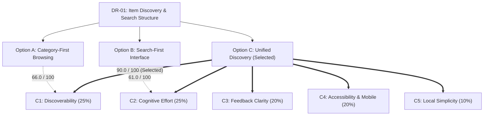

# Design Decision DR-01: Item Discovery and Search Structure

## 1. Decision ID and Title
- **ID**: `DR-01`
- **Title**: Item Discovery, Categorization, and Search Architecture

---

## 2. Status
**DECIDED** (Selected Option C: Unified Discovery).

---

## 3. Design Context
BorrowNest coordinates item sharing between community members. In a local-first system, listings reside directly in client storage. As an individual's catalog grows from a handful of tools to dozens of varied household, gardening, and workshop items, locating a specific item or discovering available items requires an intuitive discovery architecture.

---

## 4. Design Question
> **How should users discover, browse, and search genuine available items without unnecessary cognitive effort?**

---

## 5. Why the Question Matters
Borrowers typically enter the application with one of two distinct cognitive search intents:
1. **Specific Goal-Oriented Intent**: The user needs a precise tool (e.g., "rotary hammer drill") and wants immediate feedback on its presence and availability.
2. **Exploratory Browsing Intent**: The user has a broader, fuzzy objective (e.g., "weekend garden maintenance" or "camping gear") and seeks to explore what items neighbors have made available.

If discovery relies solely on categories, keyword seekers experience friction traversing deep taxonomic hierarchies. If discovery relies exclusively on a raw search bar, browsing users face a blank slate requiring mental recall of what might exist. The discovery architecture directly dictates time-to-discovery, mental workload, and borrower satisfaction.

---

## 6. Requirements Affected
- **FR-002**: Item Discovery (browsing active listings)
- **FR-003**: Search and Filtering (keyword search, category filtering, availability status)
- **FR-004**: Item Detail Inspection (navigating from discovery cards to detail views)
- **NFR-001**: Usability & Interaction (minimizing steps, clear feedback)
- **NFR-002**: Accessibility (keyboard navigable, screen reader landmarks)

---

## 7. Relevant Usability and HCI Principles
- **Nielsen Heuristic #6 (Recognition Rather than Recall)**: Providing visible category pills and active filter badges allows users to recognize choices rather than recall item names from memory.
- **Nielsen Heuristic #7 (Flexibility and Efficiency of Use)**: Combining instant search with category shortcuts accelerates discovery for both expert searchers and casual browsers.
- **Nielsen Heuristic #9 (Help Users Recognize, Diagnose, and Recover from Errors)**: Providing explicit zero-result feedback with a single-click "Clear All Filters" button prevents navigational dead ends.
- **WCAG 2.2 SC 3.3.2 (Labels or Instructions)**: Ensuring the search input features a visible, programmatic label and clear instructional placeholder.

---

## 8. Alternatives Considered

### Option A: Category-First Hierarchical Browsing
- Users navigate through a formal taxonomic tree (e.g., *Tools* $\rightarrow$ *Power Tools* $\rightarrow$ *Drills*).
- Search is either hidden behind secondary navigation or omitted entirely.
- Suited for static, highly structured libraries.

### Option B: Search-First Interface
- A prominent search input dominates the discovery view.
- No visible category hierarchy or browsing pills on the initial screen.
- Results appear strictly in response to entered query strings.

### Option C: Unified Discovery (Search, Categorical Pills, Progressive Filters)
- Prominent persistent search input with clear labeling.
- Horizontally scrollable or wrapping category filter pills (*All*, *Tools*, *Gardening*, *Household*, *Outdoor*, *Electronics*).
- Progressive facet toggles (e.g., *Available Now* checkbox).
- Active filter indicator chips with a one-click "Reset Filters" action.
- Dedicated, honest empty state when no items match the criteria.

---

## 9. Detailed Strengths and Weaknesses

| Option | Strengths | Weaknesses |
| :--- | :--- | :--- |
| **Option A: Category-First** | • Excellent for pure exploratory browsing. • Prevents cognitive overload by partitioning items into smaller subsets. • Simple data structure for static catalogs. | • Severe friction for users seeking a known item. • Requires recall of where an item was filed (e.g., is a pole saw under *Tools* or *Gardening*?). • Sub-categories with 0 items create frustrating dead ends in small community catalogs. |
| **Option B: Search-First** | • Extremely fast for experienced users with specific item names. • Minimalist initial screen. • Compact mobile footprint. | • Paralyzing for users who do not know what items exist. • High cognitive recall burden. • Vulnerable to spelling variations and synonyms (e.g., "weed eater" vs. "string trimmer"). |
| **Option C: Unified Discovery** | • Seamlessly bridges specific search and exploratory browsing. • High recognition over recall. • Immediate visual feedback on active filter state. • Graceful recovery via filter reset buttons. | • Slightly higher initial visual density. • Requires careful mobile layout to prevent vertical clutter. |

---

## 10. Evaluation Criteria and Weights

| ID | Criterion | Weight | Justification |
| :--- | :--- | :---: | :--- |
| **C1** | **Specific & Exploratory Discoverability** | 25% | The core mission of the discovery view is enabling both targeted search and casual exploration without forcing the user into a single mode. |
| **C2** | **Cognitive Effort and Recognition** | 25% | Cognitive load is minimized when users recognize available categories rather than struggling to recall exact keywords. |
| **C3** | **Search & Filter Feedback Clarity** | 20% | Users must immediately understand how many items match their query and how to clear filters if zero results return. |
| **C4** | **Accessibility and Responsiveness** | 20% | Controls must support full keyboard navigation, screen reader labels, and touch targets across desktop and mobile screens. |
| **C5** | **Local-First Simplicity** | 10% | The filtering engine runs entirely client-side against local arrays; architectural complexity should remain lean. |
| **Total** | | **100%** | |

---

## 11. Evaluation Matrix

| Criterion | Weight | Option A: Category-First | Option B: Search-First | Option C: Unified Discovery |
| :--- | :---: | :---: | :---: | :---: |
| **C1: Discoverability** | 25% | 3 / 5 | 3 / 5 | 5 / 5 |
| **C2: Cognitive Effort** | 25% | 3 / 5 | 2 / 5 | 5 / 5 |
| **C3: Feedback Clarity** | 20% | 3 / 5 | 3 / 5 | 4 / 5 |
| **C4: Accessibility & Mobile** | 20% | 4 / 5 | 4 / 5 | 4 / 5 |
| **C5: Local Simplicity** | 10% | 4 / 5 | 4 / 5 | 4 / 5 |

---

## 12. Weighted Calculations

### Formula:
$$\text{Score} = \sum_{i=1}^{5} \left( W_i \times \frac{R_i}{5} \right)$$

- **Option A (Category-First)**:
  $$\text{Score}_A = (25 \times 0.6) + (25 \times 0.6) + (20 \times 0.6) + (20 \times 0.8) + (10 \times 0.8)$$
  $$\text{Score}_A = 15.0 + 15.0 + 12.0 + 16.0 + 8.0 = \mathbf{66.0}$$

- **Option B (Search-First)**:
  $$\text{Score}_B = (25 \times 0.6) + (25 \times 0.4) + (20 \times 0.6) + (20 \times 0.8) + (10 \times 0.8)$$
  $$\text{Score}_B = 15.0 + 10.0 + 12.0 + 16.0 + 8.0 = \mathbf{61.0}$$

- **Option C (Unified Discovery)**:
  $$\text{Score}_C = (25 \times 1.0) + (25 \times 1.0) + (20 \times 0.8) + (20 \times 0.8) + (10 \times 0.8)$$
  $$\text{Score}_C = 25.0 + 25.0 + 16.0 + 16.0 + 8.0 = \mathbf{90.0}$$

---

## 13. Rating Justifications
- **C1 (Discoverability)**: Option C scores 5/5 because it handles both targeted keyword searching and category-based exploration concurrently. Options A and B receive 3/5 because each serves only one search intent well while penalizing the other.
- **C2 (Cognitive Effort)**: Option C scores 5/5 because visible category chips externalize memory cues (recognition over recall). Option B scores 2/5 due to the high recall burden of an empty search bar. Option A scores 3/5 due to taxonomic classification guessing.
- **C3 (Feedback Clarity)**: Option C scores 4/5 by providing visible active filter chips, matching result counts, and clear zero-state recovery. Options A and B score 3/5 due to narrow feedback contexts.
- **C4 (Accessibility & Mobile)**: All options score 4/5. Option C requires careful responsive flex-wrapping and accessible ARIA live regions for filtered counts, which is thoroughly achievable using standard semantic markup.
- **C5 (Local Simplicity)**: All options score 4/5. In a local-first client, filtering a local array of item records using `Array.prototype.filter` across title, category, and availability is computationally trivial and highly performant.

---

## 14. Selected Option
**Option C: Unified Discovery**.

---

## 15. Selection Rationale
Option C achieves a commanding score of **90.0 / 100**, outperforming Option A (66.0) and Option B (61.0) by a decisive margin. In community peer lending, users arrive with heterogeneous intents. By integrating an accessible keyword search box with prominent category pills and availability toggles, Option C minimizes cognitive friction while preserving rapid discovery. Furthermore, its explicit "Reset Filters" control and honest empty states safeguard against user disorientation.

---

## 16. Trade-offs Accepted
- **Visual Screen Space**: Placing both a search bar and category pills consumes approximately 110–140px of vertical header space on desktop and mobile. This trade-off is accepted because discovery velocity and clarity far outweigh marginal scroll distance.
- **Multi-Filter State Complexity**: The client state must synchronize search text, selected category, and availability toggles simultaneously. This is cleanly managed via a single React state hook or reducer in Module 04.

---

## 17. Consequences for Future Implementation
- **Module 04 (Discovery)**: The discovery view will render:
  1. An accessible search input (`<input type="search">` with associated `<label>`).
  2. Category filter buttons (`role="group"` with `aria-pressed` states).
  3. An *Available Only* checkbox toggle.
  4. A dynamic result counter (`aria-live="polite"`).
  5. An active filter summary chip row with an inline "Reset All Filters" button.
  6. Dedicated zero-match empty state with tips to broaden criteria.
- **Module 06 (Curated Demonstration Catalogue & First-Time Visitor Experience)**:
  To eliminate the empty-state barrier for first-time visitors without inserting synthetic records into users' private IndexedDB stores:
  1. A static, read-only curated demonstration catalogue of 10 genuine items across all 5 categories is rendered on Discover with locally hosted real photography and explicit `Example Item` classification badges.
  2. The visitor's private IndexedDB local inventory remains cleanly separated: genuine listings created in Lending are displayed under *My Local Listings*, while zero-item local stores honestly report `0 items in local catalog` and provide an instant link to Lending.
  3. Safe interaction handshakes prevent demonstration items from spawning fictitious borrowing requests.

---

## 18. Known Limitations
- Client-side text filtering does not include fuzzy phonetic matching (e.g., Levenshtein distance) in this baseline, requiring exact substring matches.
- In small local catalogs with few items, certain categories will initially show 0 items; the UI must communicate this honestly without feeling broken.

---

## 19. Evidence References
- **E-01 (QOC)**: MacLean et al. (1991), framing design options against usability criteria.
- **E-02 (NN/g Heuristics)**: Heuristic #6 (Recognition Rather than Recall), Heuristic #7 (Flexibility & Efficiency), Heuristic #9 (Error Recovery).
- **E-03 (WCAG 2.2)**: SC 3.3.2 (Labels or Instructions), SC 2.4.7 (Focus Visible), SC 1.3.1 (Info and Relationships).
- **E-04 (W3C Form Labels)**: Persistent `<label>` element for the search input.

---

## 20. Mermaid QOC Diagram

---

## 21. Final Decision Statement
BorrowNest adopts **Option C (Unified Discovery)** as the authoritative architecture for item exploration. Discovery will unify direct keyword searching, prominent category selector pills, and an availability toggle, backed by instant visual filter feedback and one-click reset controls.
