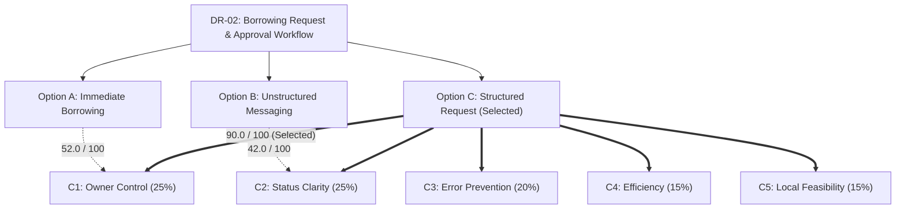

# Design Decision DR-02: Borrowing Request and Owner Approval Workflow

## 1. Decision ID and Title
- **ID**: `DR-02`
- **Title**: Borrowing Request Submission and Owner Approval State Machine

---

## 2. Status
**DECIDED** (Selected Option C: Structured Borrowing Request).

---

## 3. Design Context
BorrowNest coordinates the lending of physical items between peers. Unlike commercial rental platforms with instant credit card deposits or centralized logistics lockers, peer lending depends entirely on mutual consent, owner comfort, and explicit scheduling. A borrower must propose a loan duration, and the owner must retain the authority to accept or reject that proposal.

---

## 4. Design Question
> **How should a borrower propose a borrowing arrangement and how should the item owner make a decision?**

---

## 5. Why the Question Matters
If an application permits instant, unconfirmed checkouts without owner oversight, owners risk losing control of their possessions, double-booking items, or loaning tools when they personally need them. Conversely, if coordination relies on free-text, unstructured messaging, critical details (such as exact return dates or pickup windows) become buried in chat history, leading to confusion, forgotten returns, and interpersonal friction. A structured, predictable interaction model is necessary to establish clear expectations before physical items change hands.

---

## 6. Requirements Affected
- **FR-005**: Borrowing Request Submission (specifying dates and requester notes)
- **FR-006**: Request Decision Workflow (owner approval/rejection)
- **FR-007**: Borrowing Period Scheduling (anchoring request to explicit date range)
- **NFR-001**: Usability & Interaction (clear confirmation dialogues, distinct statuses)
- **NFR-005**: Reliability & Data Integrity (deterministic state machine, no invalid transitions)

---

## 7. Relevant Usability and HCI Principles
- **Nielsen Heuristic #1 (Visibility of System Status)**: The system must visibly display whether a request is currently `PENDING`, `APPROVED`, `DECLINED`, or `CANCELLED`.
- **Nielsen Heuristic #3 (User Control and Freedom)**: A borrower must be able to cancel an outstanding pending request if their plans change before the owner approves it.
- **Nielsen Heuristic #5 (Error Prevention)**: Prevent owners from acting on closed requests, prevent double submissions, and require confirmation before irreversible state transitions.
- **W3C Form Instructions (E-05)**: Clearly prompt the user for necessary request fields (dates and purpose note) with immediate validation feedback.

---

## 8. Alternatives Considered

### Option A: Immediate Borrowing (Instant Self-Service Checkout)
- Borrowers select an item and immediately lock in the loan without owner review.
- Mimics commercial e-commerce or library checkout workflows.

### Option B: Unstructured Messaging (Free-Text Peer Chat)
- Borrowers and owners communicate via an open-ended conversational message thread.
- Loan terms, dates, and approvals are negotiated entirely in conversational prose without formal buttons or status badges.

### Option C: Structured Borrowing Request (Formal State Machine)
- Borrower submits an explicit request with a date range and optional usage note.
- The request enters a visible, deterministic `PENDING` state.
- The owner can review all details and click to **Approve** or **Decline**.
- The borrower can **Cancel** an unapproved pending request.
- Once approved or declined, the state is sealed, preventing duplicate or conflicting actions.

---

## 9. Detailed Strengths and Weaknesses

| Option | Strengths | Weaknesses |
| :--- | :--- | :--- |
| **Option A: Immediate Borrowing** | • Instant 1-click completion.<br>• Minimal interaction steps. | • Completely deprives the owner of consent and control.<br>• High risk of physical unavailability or personal scheduling conflicts.<br>• Unsuitable for private peer-to-peer property sharing. |
| **Option B: Unstructured Messaging** | • High conversational flexibility.<br>• Allows nuanced explanations and personal introductions. | • Loan terms and dates are buried in chat text.<br>• No programmatic state to prevent overlapping bookings.<br>• Impossible to enforce deterministic collection or return tracking.<br>• Requires a complex real-time messaging server, completely infeasible in a local-first client. |
| **Option C: Structured Request** | • Upholds owner consent and scheduling control.<br>• Deterministic, auditable lifecycle states.<br>• Automated validation prevents double-booking overlaps.<br>• Clean UI feedback and error prevention. | • Requires two interaction beats: borrower submits, owner reviews.<br>• Borrower must wait for owner confirmation before proceeding. |

---

## 10. Evaluation Criteria and Weights

| ID | Criterion | Weight | Justification |
| :--- | :--- | :---: | :--- |
| **C1** | **Owner Control and Explicit Consent** | 25% | Peer lending requires that the owner maintains unilateral authority over who accesses their personal property. |
| **C2** | **Clarity of Request Details & Status** | 25% | Both parties must immediately understand the exact status, requested dates, and next required action. |
| **C3** | **Error Prevention & State Integrity** | 20% | The system must prevent duplicate requests, conflicting bookings, and invalid transitions on finalized records. |
| **C4** | **Interaction Efficiency** | 15% | The request and decision flow should be concise, requiring no more than 2–3 clear interaction steps. |
| **C5** | **Local-First Feasibility & Privacy** | 15% | The interaction model must function reliably within local browser state without exposing private data. |
| **Total** | | **100%** | |

---

## 11. Evaluation Matrix

| Criterion | Weight | Option A: Immediate | Option B: Messaging | Option C: Structured Request |
| :--- | :---: | :---: | :---: | :---: |
| **C1: Owner Control** | 25% | 1 / 5 | 3 / 5 | 5 / 5 |
| **C2: Status Clarity** | 25% | 3 / 5 | 2 / 5 | 5 / 5 |
| **C3: Error Prevention** | 20% | 2 / 5 | 2 / 5 | 4 / 5 |
| **C4: Interaction Efficiency** | 15% | 5 / 5 | 2 / 5 | 4 / 5 |
| **C5: Local-First Feasibility** | 15% | 3 / 5 | 1 / 5 | 4 / 5 |

---

## 12. Weighted Calculations

### Formula:
$$\text{Score} = \sum_{i=1}^{5} \left( W_i \times \frac{R_i}{5} \right)$$

- **Option A (Immediate Borrowing)**:
  $$\text{Score}_A = (25 \times 0.2) + (25 \times 0.6) + (20 \times 0.4) + (15 \times 1.0) + (15 \times 0.6)$$
  $$\text{Score}_A = 5.0 + 15.0 + 8.0 + 15.0 + 9.0 = \mathbf{52.0}$$

- **Option B (Unstructured Messaging)**:
  $$\text{Score}_B = (25 \times 0.6) + (25 \times 0.4) + (20 \times 0.4) + (15 \times 0.4) + (15 \times 0.2)$$
  $$\text{Score}_B = 15.0 + 10.0 + 8.0 + 6.0 + 3.0 = \mathbf{42.0}$$

- **Option C (Structured Request)**:
  $$\text{Score}_C = (25 \times 1.0) + (25 \times 1.0) + (20 \times 0.8) + (15 \times 0.8) + (15 \times 0.8)$$
  $$\text{Score}_C = 25.0 + 25.0 + 16.0 + 12.0 + 12.0 = \mathbf{90.0}$$

---

## 13. Rating Justifications
- **C1 (Owner Control)**: Option C scores 5/5 because it guarantees explicit owner approval before an item is reserved. Option A scores 1/5 because it eliminates owner consent entirely. Option B scores 3/5 because consent is informal and easily misconstrued.
- **C2 (Status Clarity)**: Option C scores 5/5 by introducing distinct, non-overlapping status badges (`PENDING`, `APPROVED`, `DECLINED`, `CANCELLED`). Option B scores 2/5 because agreement states remain ambiguous in free-text prose. Option A scores 3/5.
- **C3 (Error Prevention)**: Option C scores 4/5 by enforcing deterministic transitions and disallowing actions on closed requests. Options A and B score 2/5 due to vulnerability to scheduling collisions and double bookings.
- **C4 (Efficiency)**: Option A scores 5/5 for raw speed (1 click). Option C scores 4/5 by keeping the modal form to essential dates and a single approval click. Option B scores 2/5 due to lengthy messaging back-and-forth.
- **C5 (Local-First Feasibility)**: Option C scores 4/5 because a finite state machine maps directly to local browser state and `localStorage` records. Option B scores 1/5 because conversational messaging requires WebSockets, message brokers, and centralized servers incompatible with local-first client operation.

---

## 14. Selected Option
**Option C: Structured Borrowing Request**.

---

## 15. Selection Rationale
Option C achieves the highest overall evaluation with **90.0 / 100**, dramatically outperforming Option A (52.0) and Option B (42.0). Option C establishes the necessary balance between borrower convenience and owner peace-of-mind. By formalizing the request lifecycle into distinct states, both parties benefit from unambiguous records, automated overlap conflict prevention, and clear operational checkpoints.

---

## 16. State Model Specification

The request state model consists of one initial state and three alternative terminal transitions:

```text
               +--------------------+
               |      PENDING       |
               +--------------------+
                 /        |        \
    [Owner Accepts]  [Owner Declines]  [Borrower Cancels]
              v           v                   v
      +------------+  +------------+     +-------------+
      |  APPROVED  |  |  DECLINED  |     |  CANCELLED  |
      +------------+  +------------+     +-------------+
```

### Transition Invariants:
1. `PENDING` $\rightarrow$ `APPROVED`: Only the item owner can trigger this transition. Triggers secondary validation against existing active loans.
2. `PENDING` $\rightarrow$ `DECLINED`: Triggered by the owner. Releases any tentative hold; no further status transitions permitted.
3. `PENDING` $\rightarrow$ `CANCELLED`: Triggered unilaterally by the borrower prior to approval.
4. Terminal Integrity: Once a request reaches `APPROVED`, `DECLINED`, or `CANCELLED`, it cannot transition to another state or be re-opened.

---

## 17. Critical Local-First Limitation
> [!IMPORTANT]
> **Local Interaction Simulation Boundary**: In the current local-first client prototype, all data resides in the user's browser runtime. Submitting a borrowing request and approving that request represent a local interaction and state-management model. It does **not** deliver a network push notification or cross-device message to an external person. The prototype does not simulate fake external users; both perspectives operate within the local application workspace.

---

## 18. Consequences for Future Implementation
- **Module 05 (Borrowing Workflow)**: Implement the request modal containing start date, return date, and request notes. Provide distinct UI cards in the "Lending" section for pending incoming requests with explicit "Approve" and "Decline" buttons.

---

## 19. Evidence References
- **E-01 (QOC)**: MacLean et al. (1991), structuring options against multi-stakeholder criteria.
- **E-02 (NN/g Heuristics)**: Heuristic #1 (Visibility of System Status), Heuristic #3 (User Freedom), Heuristic #5 (Error Prevention).
- **E-05 (W3C Form Instructions)**: Providing clear validation rules on requested date intervals.

---

## 20. Mermaid QOC Diagram



---

## 21. Final Decision Statement
BorrowNest adopts **Option C (Structured Borrowing Request)**. The borrowing flow will enforce explicit owner approval, structured start and return deadlines, a deterministic state machine (`PENDING`, `APPROVED`, `DECLINED`, `CANCELLED`), and robust error prevention disallowing actions on finalized requests.
