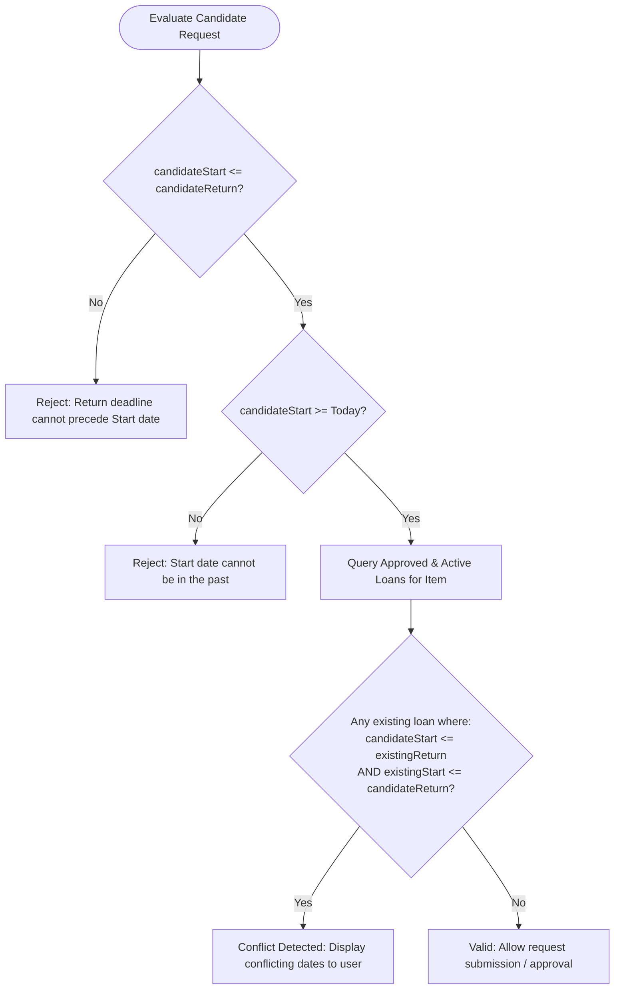
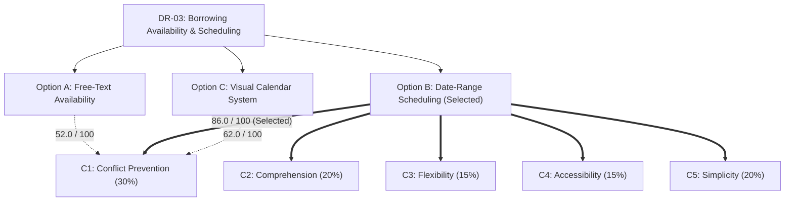

# Design Decision DR-03: Borrowing Availability and Scheduling

## 1. Decision ID and Title
- **ID**: `DR-03`
- **Title**: Availability Representation, Date-Range Scheduling, and Conflict Prevention

---

## 2. Status
**IMPLEMENTED & VERIFIED** in Module 05 (Selected Option B: Explicit Date-Range Scheduling with inclusive conflict prevention and transactional atomic verification).

---

## 3. Design Context
To make item lending viable and prevent awkward interpersonal conflicts, BorrowNest must provide unambiguous scheduling. When an item is borrowed, both the lender and borrower need clear visibility into the pickup date and the agreed return deadline. The system must prevent two borrowers from booking the same item over conflicting dates.

---

## 4. Design Question
> **How should availability and requested loan periods be represented so that users understand when an item can be borrowed and double-bookings are prevented?**

---

## 5. Why the Question Matters
Scheduling conflicts are one of the most common friction points in informal peer lending. If a borrower promises to return a power saw on Sunday afternoon, but another borrower was promised the saw on Saturday morning, both parties face disruption and the lender is caught in the middle. Conversely, an overly complex scheduling interface with 15-minute time slots and rigid calendar synchronization introduces unnecessary cognitive load for casual household tools. An optimal balance must provide mathematical collision prevention while remaining lightweight and accessible.

---

## 6. Requirements Affected
- **FR-007**: Borrowing Period Scheduling (start date and return deadline)
- **FR-008**: Collection & Return Logging (tracking loan duration)
- **FR-010**: Borrowing History & Status (upcoming deadlines, overdue detection)
- **NFR-001**: Usability & Interaction (clear date pickers and error messaging)
- **NFR-005**: Reliability & Data Integrity (deterministic overlap validation)

---

## 7. Relevant Usability and HCI Principles
- **Nielsen Heuristic #5 (Error Prevention)**: Prevent users from selecting return dates that precede start dates, and automatically flag overlapping conflicts before the owner confirms approval.
- **Nielsen Heuristic #9 (Help Users Recognize, Diagnose, and Recover from Errors)**: If a requested date range clashes with an existing loan, display a clear, plain-language error message explaining the exact conflicting date span.
- **WCAG 2.2 SC 3.3.1 (Error Identification) & SC 3.3.2 (Labels or Instructions)**: Date inputs must have explicit visual and programmatic labels, clear expected format hints, and inline error text.
- **W3C Form Instructions (E-05)**: Standard accessible date pickers allow both manual typing and native calendar dropdown interaction.

---

## 8. Alternatives Considered

### Option A: Free-Text Availability Notes
- Owners describe availability in natural prose (e.g., "Available most weekends in October except the 14th").
- Borrowers propose dates inside a message text box.
- No algorithmic collision detection or validation.

### Option B: Explicit Date-Range Scheduling (Start Date & Return Deadline)
- Borrower selects a distinct **Collection Date** and **Return Deadline** using standard accessible date inputs.
- Inclusive date-range conflict algorithm validates against all currently approved or active loans.
- Re-validates at approval time to prevent race conditions.
- Displays explicit conflict messages and highlights active loan intervals.

### Option C: Full Interactive Visual Calendar System
- Multi-month interactive grid UI with color-coded day cells.
- Advanced capabilities: recurring hourly slots, configurable buffer times between loans, holiday exceptions, and external `.ics` syncing.

---

## 9. Detailed Strengths and Weaknesses

| Option | Strengths | Weaknesses |
| :--- | :--- | :--- |
| **Option A: Free-Text** | • Zero configuration burden. • Maximum initial flexibility for complex schedules. | • Unparseable by software; zero automated conflict prevention. • Inevitable scheduling collisions and double bookings. • Unstructured text is difficult for screen readers to navigate as a schedule. |
| **Option B: Date-Range Scheduling** | • 100% deterministic overlap detection. • High usability on both desktop and mobile using native HTML5 date controls. • Clear conceptual distinction between collection date and return deadline. • Zero external dependencies or bundle bloat. | • Does not support sub-day hourly slots (e.g., 2:00 PM to 4:00 PM). • Lacks a multi-month bird's-eye view on a single screen. |
| **Option C: Visual Calendar System** | • Rich visual overview of month-by-month occupancy. • Supports micro-slotting and buffer intervals. | • Heavy third-party library footprint (50–100 kB+ overhead). • Calendar grids are notorious accessibility barriers for keyboard users and screen readers. • Poor ergonomic experience on small 320px mobile screens. • Disproportionate engineering complexity for peer item lending. |

---

## 10. Evaluation Criteria and Weights

| ID | Criterion | Weight | Justification |
| :--- | :--- | :---: | :--- |
| **C1** | **Conflict Prevention & Reliability** | 30% | The primary objective of scheduling is mathematically eliminating double bookings and overlapping commitments. |
| **C2** | **Date & Availability Comprehension** | 20% | Users must instantly grasp when an item is available and when it is expected back. |
| **C3** | **User Flexibility** | 15% | The model should accommodate arbitrary day spans (single day, weekend, multi-week) without rigid artificial slots. |
| **C4** | **Accessibility & Error Recovery** | 15% | Date controls must be fully operable via keyboard, screen reader, and provide clear error messages. |
| **C5** | **Implementation Simplicity** | 20% | The scheduling logic should remain lean, deterministic, and free of heavy external dependencies. |
| **Total** | | **100%** | |

---

## 11. Evaluation Matrix

| Criterion | Weight | Option A: Free-Text | Option B: Date-Range | Option C: Visual Calendar |
| :--- | :---: | :---: | :---: | :---: |
| **C1: Conflict Prevention** | 30% | 1 / 5 | 5 / 5 | 4 / 5 |
| **C2: Comprehension** | 20% | 2 / 5 | 4 / 5 | 4 / 5 |
| **C3: Flexibility** | 15% | 4 / 5 | 4 / 5 | 4 / 5 |
| **C4: Accessibility & Errors** | 15% | 2 / 5 | 4 / 5 | 2 / 5 |
| **C5: Implementation Simplicity** | 20% | 5 / 5 | 4 / 5 | 1 / 5 |

---

## 12. Weighted Calculations

### Formula:
$$\text{Score} = \sum_{i=1}^{5} \left( W_i \times \frac{R_i}{5} \right)$$

- **Option A (Free-Text)**:
  $$\text{Score}_A = (30 \times 0.2) + (20 \times 0.4) + (15 \times 0.8) + (15 \times 0.4) + (20 \times 1.0)$$
  $$\text{Score}_A = 6.0 + 8.0 + 12.0 + 6.0 + 20.0 = \mathbf{52.0}$$

- **Option B (Explicit Date-Range Scheduling)**:
  $$\text{Score}_B = (30 \times 1.0) + (20 \times 0.8) + (15 \times 0.8) + (15 \times 0.8) + (20 \times 0.8)$$
  $$\text{Score}_B = 30.0 + 16.0 + 12.0 + 12.0 + 16.0 = \mathbf{86.0}$$

- **Option C (Visual Calendar System)**:
  $$\text{Score}_C = (30 \times 0.8) + (20 \times 0.8) + (15 \times 0.8) + (15 \times 0.4) + (20 \times 0.2)$$
  $$\text{Score}_C = 24.0 + 16.0 + 12.0 + 6.0 + 4.0 = \mathbf{62.0}$$

---

## 13. Rating Justifications
- **C1 (Conflict Prevention)**: Option B scores 5/5 because its inclusive interval intersection rule guarantees zero conflicting active loans. Option A scores 1/5 because it has no algorithmic check. Option C scores 4/5 due to edge-case bugs around timezone parsing in complex calendar widgets.
- **C2 (Comprehension)**: Option B and Option C score 4/5 by making loan periods explicit. Option A scores 2/5 due to ambiguous conversational dates (e.g., "next Friday").
- **C3 (Flexibility)**: All options score 4/5. Option B allows any valid day-based range from 1 day to several weeks.
- **C4 (Accessibility & Errors)**: Option B scores 4/5 using standard HTML5 date inputs with explicit programmatic labels and inline error descriptions. Option C scores 2/5 because custom interactive grid calendars are notoriously inaccessible to keyboard and screen reader users. Option A scores 2/5.
- **C5 (Implementation Simplicity)**: Option A scores 5/5. Option B scores 4/5 with a clean 10-line mathematical overlap check. Option C scores 1/5 due to massive library dependencies, state complexity, and mobile responsive overhead.

---

## 14. Selected Option
**Option B: Explicit Date-Range Scheduling**.

---

## 15. Selection Rationale
Option B achieves the highest score of **86.0 / 100**, soundly defeating Option A (52.0) and Option C (62.0). Option B delivers uncompromising collision prevention and accessible form interaction without burdening the application with heavy third-party calendar dependencies. It provides the exact degree of rigor needed for neighborhood tool lending.

---

## 16. Algorithmic Conflict Rule Specification

### Interval Definition:
All loan periods are evaluated as inclusive calendar date intervals:
- **Candidate Request**: $[\text{candidateStart}, \text{candidateReturn}]$
- **Existing Loan**: $[\text{existingStart}, \text{existingReturn}]$

### Overlap Condition:
Two intervals overlap if and only if:
$$\text{candidateStart} \le \text{existingReturn} \quad \text{AND} \quad \text{existingStart} \le \text{candidateReturn}$$

### Scheduling Invariants:
1. **Pending Non-Blocking Rule**: A `PENDING` request does **not** block availability. Multiple pending requests may be submitted for the same timeframe.
2. **Approval Lock Rule**: Only an `APPROVED` or active loan blocks calendar dates.
3. **Double-Check on Approval**: When the owner clicks "Approve" on a pending request, the overlap validation executes again. If another request for that period was approved moments earlier, the second approval is rejected with an explicit notice, preventing race conditions.
4. **Physical Return Hold**: If an item is not physically returned by the deadline, it remains marked as `OVERDUE` and unavailable for new bookings until the return event is formally logged.

---

## 17. Consequences for Future Implementation
- **Module 05 (Borrowing Workflow)**: Implement date range selector with `<input type="date">` controls, min-date constraints set to today, and the inclusive overlap check function.
- **Module 06 (Handover & Return)**: Feed active loan dates into item detail cards, displaying "Unavailable until [Date]" badges.

---

## 18. Known Limitations
- Time-of-day precision (e.g., 10:00 AM vs 4:00 PM) is intentionally not modeled; all loans operate on whole calendar day boundaries.
- Timezone handling assumes the browser's local timezone.

---

## 19. Evidence References
- **E-01 (QOC)**: MacLean et al. (1991), structuring options against conflict prevention.
- **E-02 (NN/g Heuristics)**: Heuristic #5 (Error Prevention), Heuristic #9 (Error Diagnosis & Recovery).
- **E-03 (WCAG 2.2)**: SC 3.3.1 (Error Identification), SC 3.3.2 (Labels or Instructions).
- **E-05 (W3C Form Instructions)**: Explicit validation hints for date formats.

---

## 20. Mermaid QOC Diagram

---

## 21. Final Decision Statement
BorrowNest adopts **Option B (Explicit Date-Range Scheduling)**. Availability and borrowing periods will be defined using explicit start dates and return deadlines, governed by deterministic inclusive interval conflict checks (`candidateStart <= existingReturn AND existingStart <= candidateReturn`) without heavy third-party calendar libraries.
