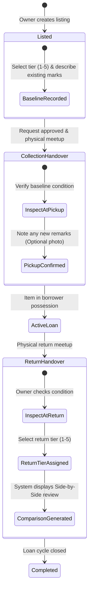
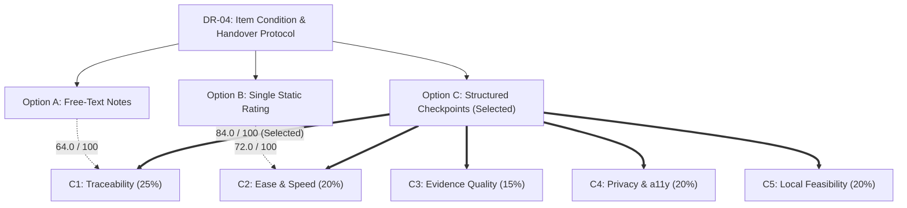

# Design Decision DR-04: Item Condition and Handover Documentation

## 1. Decision ID and Title
- **ID**: `DR-04`
- **Title**: Item Condition Checkpoints and Handover Inspection Protocol

---

## 2. Status
**DECIDED** (Selected Option C: Structured Condition Checkpoints).

---

## 3. Design Context
When physical tools, appliances, or recreational items circulate among neighbors, normal wear-and-tear occurs. A primary hesitation preventing people from lending their belongings is the anxiety that an item will be returned broken, scratched, or missing parts, accompanied by disputed recollections of the item's prior condition. Establishing a clear, honest, and lightweight record of condition at critical handover moments builds trust and eliminates ambiguity.

---

## 4. Design Question
> **How should item condition be recorded before, during, and after borrowing to reduce misunderstandings without creating excessive interaction burden?**

---

## 5. Why the Question Matters
If an application captures zero condition information, lenders bear all the risk and borrowers have no way to demonstrate that a pre-existing scratch was already there before they picked up the item. Conversely, if the application imposes a burdensome 20-point mechanical inspection checklist with mandatory notary signatures, users will abandon the protocol and revert to informal verbal lending. The condition protocol must capture meaningful evidence at minimal interaction cost.

---

## 6. Requirements Affected
- **FR-008**: Collection and Return Logging (timestamping physical handoffs)
- **FR-009**: Item Condition Record (condition classification, notes, photos, comparison)
- **NFR-004**: Data Privacy & Security (client-side EXIF GPS stripping)
- **NFR-005**: Reliability & Data Integrity (honest records, genuine user images only)

---

## 7. Relevant Usability and HCI Principles
- **Nielsen Heuristic #2 (Match Between System and the Real World)**: Condition categories must reflect common, natural language descriptions understood by everyday tool owners.
- **Nielsen Heuristic #5 (Error Prevention)**: Standardized condition grades prevent vague, unhelpful descriptions (e.g., "fine") and provide a baseline for comparison.
- **Nielsen Heuristic #8 (Aesthetic and Minimalist Design)**: Keep condition logging forms concise, prompting only for standard tier, specific notes, and optional photo attachment.
- **WCAG 2.2 SC 3.3.2 (Labels or Instructions)**: Clear definitions for each condition tier so users select appropriate grades consistently.

---

## 8. Alternatives Considered

### Option A: Free-Text Notes Only
- Item owners and borrowers type unguided notes into an open text box at listing and return.
- No structured condition tiers or side-by-side comparison interfaces.

### Option B: Single Static Condition Rating at Listing
- The owner selects a condition grade once when first listing the item.
- No subsequent verification or condition recording occurs at collection or return.

### Option C: Structured Condition Checkpoints (Listing $\rightarrow$ Collection $\rightarrow$ Return)
- **Listing Baseline**: Owner assigns a standardized condition tier and notes known quirks.
- **Collection Checkpoint**: Borrower and owner confirm condition upon physical handoff; optional photo upload.
- **Return Checkpoint**: Owner inspects the item upon return, records current tier, and logs observations.
- **Comparative Review**: The application presents a side-by-side comparison of initial vs. return condition.

---

## 9. Standard Condition Tiers

BorrowNest defines five clear, standardized condition tiers:

| Tier | Name | Operational Definition |
| :---: | :--- | :--- |
| **5** | **Like New** | Pristine condition. Barely used, no noticeable cosmetic blemishes, fully functional with all original parts. |
| **4** | **Good** | Minor cosmetic wear from normal use (e.g., slight scratches, scuffs), but fully operational and well maintained. |
| **3** | **Fair** | Noticeable cosmetic wear, heavy use marks, or minor non-critical defects; primary functionality remains sound. |
| **2** | **Poor** | Substantial wear, cosmetic damage, or partial impairment; requires careful handling or imminent maintenance. |
| **1** | **Not Functional** | Broken, incomplete, or hazardous; suitable only for parts, repair, or refurbishment. |

---

## 10. Detailed Strengths and Weaknesses

| Option | Strengths | Weaknesses |
| :--- | :--- | :--- |
| **Option A: Free-Text Notes** | • Quick and unconstrained. • Flexible for unique items. | • Highly subjective and inconsistent. • Difficult to programmatically compare baseline vs. return. • Critical flaws often omitted due to lack of prompts. |
| **Option B: Single Static Rating** | • Lowest interaction burden. • Fast listing creation. | • Zero accountability during the loan lifecycle. • Fails to record new damage or maintenance needs upon return. • Provides no evidence if a dispute arises. |
| **Option C: Structured Checkpoints** | • Complete lifecycle traceability (Listing $\rightarrow$ Collection $\rightarrow$ Return). • Standardized tiers ensure consistent meaning. • Optional genuine user photos provide visual clarity. • Transparent side-by-side comparison. | • Requires active participation at collection and return (1–2 minutes). • Storing user photos locally requires client-side compression. |

---

## 11. Evaluation Criteria and Weights

| ID | Criterion | Weight | Justification |
| :--- | :--- | :---: | :--- |
| **C1** | **Condition Traceability & Comparison** | 25% | The protocol must clearly reveal whether an item's condition changed between collection and return. |
| **C2** | **Ease and Speed of Completion** | 20% | The logging process must be lightweight to encourage consistent adoption during real-world handoffs. |
| **C3** | **Evidence Quality and Transparency** | 15% | Checkpoints should provide clear, credible records to resolve misunderstandings amicably. |
| **C4** | **Privacy and Accessibility** | 20% | Photo attachments must strip EXIF metadata, and forms must adhere to accessible labeling standards. |
| **C5** | **Local-First Technical Feasibility** | 20% | Images and records must store efficiently within browser storage quotas without remote servers. |
| **Total** | | **100%** | |

---

## 12. Evaluation Matrix

| Criterion | Weight | Option A: Free-Text | Option B: Static Rating | Option C: Checkpoints |
| :--- | :---: | :---: | :---: | :---: |
| **C1: Traceability** | 25% | 2 / 5 | 2 / 5 | 5 / 5 |
| **C2: Ease & Speed** | 20% | 3 / 5 | 5 / 5 | 3 / 5 |
| **C3: Evidence Quality** | 15% | 2 / 5 | 2 / 5 | 5 / 5 |
| **C4: Privacy & a11y** | 20% | 4 / 5 | 4 / 5 | 4 / 5 |
| **C5: Local Feasibility** | 20% | 5 / 5 | 5 / 5 | 4 / 5 |

---

## 13. Weighted Calculations

### Formula:
$$\text{Score} = \sum_{i=1}^{5} \left( W_i \times \frac{R_i}{5} \right)$$

- **Option A (Free-Text Notes)**:
  $$\text{Score}_A = (25 \times 0.4) + (20 \times 0.6) + (15 \times 0.4) + (20 \times 0.8) + (20 \times 1.0)$$
  $$\text{Score}_A = 10.0 + 12.0 + 6.0 + 16.0 + 20.0 = \mathbf{64.0}$$

- **Option B (Single Static Rating)**:
  $$\text{Score}_B = (25 \times 0.4) + (20 \times 1.0) + (15 \times 0.4) + (20 \times 0.8) + (20 \times 1.0)$$
  $$\text{Score}_B = 10.0 + 20.0 + 6.0 + 16.0 + 20.0 = \mathbf{72.0}$$

- **Option C (Structured Condition Checkpoints)**:
  $$\text{Score}_C = (25 \times 1.0) + (20 \times 0.6) + (15 \times 1.0) + (20 \times 0.8) + (20 \times 0.8)$$
  $$\text{Score}_C = 25.0 + 12.0 + 15.0 + 16.0 + 16.0 = \mathbf{84.0}$$

---

## 14. Rating Justifications
- **C1 (Traceability)**: Option C scores 5/5 by creating an auditable comparison across listing, collection, and return. Options A and B score 2/5 due to absent return documentation.
- **C2 (Ease & Speed)**: Option B scores 5/5 (a single dropdown at listing). Option A scores 3/5. Option C scores 3/5 because completing quick checkpoints at handoff and return requires 1–2 minutes of user effort.
- **C3 (Evidence Quality)**: Option C scores 5/5 by pairing standardized tiers with specific notes and optional photos. Options A and B score 2/5.
- **C4 (Privacy & a11y)**: All options score 4/5. Option C requires client-side EXIF stripping when users upload optional photos, which is standard practice in privacy-first web applications.
- **C5 (Local Feasibility)**: Options A and B score 5/5. Option C scores 4/5 because image files must be resized and compressed on the client before being stored in `localStorage` or `IndexedDB`.

---

## 15. Selected Option
**Option C: Structured Condition Checkpoints**.

---

## 16. Selection Rationale
Option C achieves a score of **84.0 / 100**, exceeding Option B (72.0) and Option A (64.0). While Option B is faster to fill out, it fails the central purpose of condition management: protecting both parties against post-loan disputes. Option C provides the necessary traceability across the entire lifecycle while keeping the interaction lightweight.

---

## 17. Crucial Evidence Distinction & Real Image Policy

> [!IMPORTANT]
> **Legal Distinction**: A recorded condition tier, textual observation, or user-uploaded photograph is an **informational record** designed to foster peer transparency. It does **not** constitute a legally binding contract, digital signature, or automated liability determination. The software never adjudicates financial claims.
>
> **Strict Asset Integrity**:
> 1. Photographs must be **genuine photos** taken of the actual physical item by the user.
> 2. Zero generic stock photos, AI-generated images, or synthetic before/after demonstrations are permitted.
> 3. Uploaded photos must undergo client-side canvas-based EXIF stripping to remove GPS coordinates before storage.
> 4. Photos are stored locally as compressed WebP/JPEG data strings within browser storage quotas.

---

## 18. Handover Lifecycle Diagram

---

## 19. Consequences for Future Implementation
- **Module 06 (Condition & Return)**: Build the condition handover component featuring:
  - Standardized tier dropdown with descriptive labels.
  - Descriptive notes text area.
  - Client-side image upload with canvas resizing and EXIF stripping.
  - Side-by-side comparison card displaying baseline vs. return observations.

---

## 20. Mermaid QOC Diagram

---

## 21. Final Decision Statement
BorrowNest adopts **Option C (Structured Condition Checkpoints)**. Item condition will be captured using standardized 5-tier grades at listing creation, verified upon collection handoff, and re-inspected upon return, supported by optional authentic user-uploaded photographs with client-side EXIF GPS removal.
