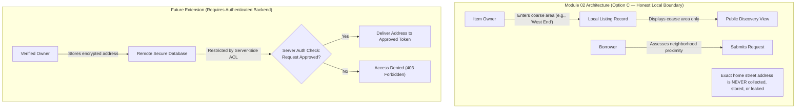
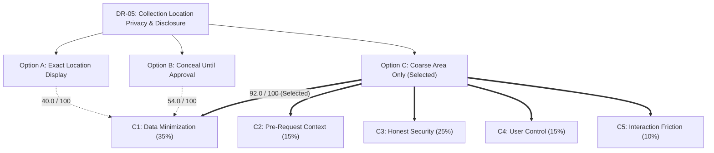

# Design Decision DR-05: Collection Location Privacy and Disclosure

## 1. Decision ID and Title
- **ID**: `DR-05`
- **Title**: Collection Location Disclosure, Spatial Privacy, and Local-First Security Boundary

---

## 2. Status
**DECIDED** (Selected Option C: Coarse Area Only in the Current Prototype).

---

## 3. Design Context
Physical item sharing requires that the borrower travel to collect the item. In community sharing, this handoff frequently occurs at the lender's home or a nearby neighborhood rendezvous point. Residential street addresses and apartment unit numbers are highly sensitive personal information. How location is handled directly impacts user physical safety, privacy, and willingness to share tools.

---

## 4. Design Question
> **How should BorrowNest communicate collection proximity while minimizing exposure of sensitive residential information?**

---

## 5. Why the Question Matters
If an application displays exact home addresses publicly on item listings, lenders face serious privacy and physical safety risks, including unauthorized visits, property surveillance, and data harvesting. Conversely, if zero geographical information is displayed prior to approval, borrowers cannot gauge whether an item is within walking distance or a 45-minute drive away, leading to blind requests and high cancellation rates.

Crucially, the application architecture dictates what security guarantees can honestly be made. In a **local-first, client-only web application** without an authenticated backend, attempting to "hide" private data behind a React state condition (such as `isApproved === true`) provides **zero cryptographic or architectural security**. Any data loaded into the client's browser is trivial to inspect in memory or developer tools.

---

## 6. Requirements Affected
- **FR-004**: Item Detail Inspection (displaying approximate collection zone)
- **FR-008**: Collection and Return Logging (coordinating physical handoff)
- **NFR-004**: Data Privacy & Security (data minimization, zero address harvesting)
- **NFR-005**: Reliability & Data Integrity (honest security boundaries)

---

## 7. Relevant Usability and HCI Principles
- **Nielsen Heuristic #2 (Match Between System and the Real World)**: Everyday community members understand familiar neighborhood names, districts, and public landmarks (e.g., "Oakwood / Near North Library") without requiring precise geographic coordinates.
- **Nielsen Heuristic #8 (Aesthetic and Minimalist Design)**: Omit unnecessary, invasive data fields (exact street, unit number, postal code, GPS coordinates) from the item listing form.
- **Privacy by Design (Data Minimization)**: If data is not strictly necessary for the current system architecture, it should not be collected or stored at all.

---

## 8. Alternatives Considered

### Option A: Exact Location Display
- Full residential address and specific handoff notes (e.g., "142 Elm St, back porch keybox code 1234") are entered by the owner and displayed directly on the public listing.

### Option B: Zero Location Display Until Approval
- Listings display no geographic or proximity information whatsoever.
- The owner enters an exact address, which the UI hides until the owner clicks "Approve".

### Option C: Coarse Area Only in the Current Prototype (Architecturally Honest Privacy)
- Item listings display only a **general, user-entered coarse locality** (e.g., "Riverside District", "Near Downtown Community Center").
- **Exact residential street addresses, lockbox codes, and sensitive porch instructions are deliberately NOT collected or stored in the local-first prototype.**
- Post-approval private disclosure of exact addresses is formally recognized as a future capability requiring authenticated user identities, server-side authorization filters, and encrypted persistence.

---

## 9. Detailed Strengths and Weaknesses

| Option | Strengths | Weaknesses |
| :--- | :--- | :--- |
| **Option A: Exact Location** | • Maximum borrower convenience. • Instant routing and navigation. | • Catastrophic privacy and physical safety hazard. • Broadcasts home addresses of tool owners. • Encourages property theft and harassment. |
| **Option B: Conceal Until Approval** | • Withholds address during initial browsing. | • Severe usability failure: borrowers cannot assess collection viability. • **False Sense of Security**: In a client-only prototype, data stored in `localStorage` or React state is accessible via browser dev tools. Hiding it via a UI toggle is pseudo-security. |
| **Option C: Coarse Area Only** | • **Zero Privacy Leakage**: Exact home addresses simply do not exist in the database or client memory. • Provides sufficient proximity context for borrowers to evaluate convenience. • **Architecturally Honest**: Eliminates pseudo-security claims. • Low data-entry friction for owners. | • Requires parties in a future live deployment to coordinate exact final handoff details externally or via future authenticated backend modules. |

---

## 10. Evaluation Criteria and Weights

| ID | Criterion | Weight | Justification |
| :--- | :--- | :---: | :--- |
| **C1** | **Sensitive Location Data Minimization** | 35% | Protecting homeowner physical security and preventing address harvesting is the foremost ethical imperative. |
| **C2** | **Useful Location Context Pre-Request** | 15% | Borrowers need sufficient geographic cues to determine whether pickup is feasible before submitting a request. |
| **C3** | **Honest Security & Technical Feasibility** | 25% | The architecture must not make deceptive security claims that cannot be enforced in a client-side environment. |
| **C4** | **User Control and Transparency** | 15% | Owners must have clear control over how their general neighborhood is described without automated geolocation tracking. |
| **C5** | **Interaction Friction** | 10% | Location input should be simple and non-intrusive. |
| **Total** | | **100%** | |

---

## 11. Evaluation Matrix

| Criterion | Weight | Option A: Exact Location | Option B: Conceal Until Approval | Option C: Coarse Area Only |
| :--- | :---: | :---: | :---: | :---: |
| **C1: Data Minimization** | 35% | 1 / 5 | 4 / 5 | 5 / 5 |
| **C2: Useful Pre-Request Context** | 15% | 5 / 5 | 1 / 5 | 4 / 5 |
| **C3: Honest Security Feasibility** | 25% | 1 / 5 | 2 / 5 | 5 / 5 |
| **C4: User Control** | 15% | 1 / 5 | 3 / 5 | 4 / 5 |
| **C5: Interaction Friction** | 10% | 5 / 5 | 2 / 5 | 4 / 5 |

---

## 12. Weighted Calculations

### Formula:
$$\text{Score} = \sum_{i=1}^{5} \left( W_i \times \frac{R_i}{5} \right)$$

- **Option A (Exact Location Display)**:
  $$\text{Score}_A = (35 \times 0.2) + (15 \times 1.0) + (25 \times 0.2) + (15 \times 0.2) + (10 \times 1.0)$$
  $$\text{Score}_A = 7.0 + 15.0 + 5.0 + 3.0 + 10.0 = \mathbf{40.0}$$

- **Option B (Conceal Until Approval)**:
  $$\text{Score}_B = (35 \times 0.8) + (15 \times 0.2) + (25 \times 0.4) + (15 \times 0.6) + (10 \times 0.4)$$
  $$\text{Score}_B = 28.0 + 3.0 + 10.0 + 9.0 + 4.0 = \mathbf{54.0}$$

- **Option C (Coarse Area Only)**:
  $$\text{Score}_C = (35 \times 1.0) + (15 \times 0.8) + (25 \times 1.0) + (15 \times 0.8) + (10 \times 0.8)$$
  $$\text{Score}_C = 35.0 + 12.0 + 25.0 + 12.0 + 8.0 = \mathbf{92.0}$$

---

## 13. Rating Justifications
- **C1 (Data Minimization)**: Option C scores 5/5 because sensitive residential addresses are never gathered or stored at all. Option A scores 1/5 due to total public exposure. Option B scores 4/5 conceptually, but fails architectural enforcement.
- **C2 (Pre-Request Context)**: Option A scores 5/5 for exact routing. Option C scores 4/5 because a neighborhood name (e.g., "West End") gives 90% of the practical geographic information needed. Option B scores 1/5 because the borrower is completely blind.
- **C3 (Honest Security Feasibility)**: Option C scores 5/5 because it respects the reality of the client-side architecture. Option B scores 2/5 because claiming a React component state securely protects an address in client storage is deceptive pseudo-security. Option A scores 1/5.
- **C4 (User Control)**: Option C scores 4/5 because owners freely specify their neighborhood label without forced GPS tracking. Option A scores 1/5.
- **C5 (Interaction Friction)**: Option A scores 5/5. Option C scores 4/5 (a single optional text field). Option B scores 2/5 due to inevitable cancellations when unmasked locations prove inconvenient.

---

## 14. Selected Option
**Option C: Coarse Area Only in the Current Prototype**.

---

## 15. Selection Rationale
Option C achieves the highest score of **92.0 / 100**, decisively outperforming Option B (54.0) and Option A (40.0). By collecting only coarse, user-defined neighborhood names, BorrowNest delivers essential proximity context to borrowers while maintaining an impenetrable privacy perimeter: **what is never collected can never be leaked or breached**.

---

## 16. Mandatory Documentation Correction
> [!IMPORTANT]
> **Correction of Module 01 Documentation**:
> In Module 01 preliminary notes, a two-tier disclosure mechanism was described where exact addresses would be hidden until a local `APPROVED` state was reached.
> 
> **Architectural Correction**: In a local-first client application with no authenticated remote server, client-side UI conditional rendering is **not** an authorization security boundary. Storing an exact home address in local storage and merely toggling its display in React creates a false sense of security.
> 
> **Resolution**: For the current prototype and all local-first modules, BorrowNest will **only** support coarse neighborhood or landmark designations (e.g., "North District"). Exact residential street addresses, lockbox codes, and private entry directions will **not** be collected or stored. True authenticated post-approval disclosure is formally reserved for future enterprise or cloud-synchronized releases backed by cryptographically verified identity providers and server-side authorization controls.

---

## 17. Architecture Comparison Diagram

---

## 18. Consequences for Future Implementation
- **Module 03 (Item Listing Creation)**: Form contains an optional field: `Approximate Area` (e.g., `<input type="text" placeholder="e.g. Westside / Near Park">`) with instructional helper text and client-side heuristic validation warning against exact street numbers or apartment strings (*"For your privacy, do not enter your exact home street address or apartment number."*).
- **Security Boundary Clarification**: In this local-first architecture, this client-side heuristic validation is a UX behavioral nudge for error prevention (Nielsen Heuristic #5), not a cryptographic access control or tamper-proof security barrier. True confidentiality is achieved purely through **data minimization**: because exact addresses are never collected, stored, or transmitted, there is no sensitive residential data in IndexedDB or memory that can be exfiltrated.
- **Module 04 (Discovery)**: Display the coarse area badge on item cards.

---

## 19. Evidence References
- **E-01 (QOC)**: MacLean et al. (1991), evaluating privacy and security trade-offs.
- **E-02 (NN/g Heuristics)**: Heuristic #2 (Match Real World), Heuristic #8 (Minimalist Design).
- **Privacy by Design**: Cavoukian, A. (2009). *Privacy by Design: The 7 Foundational Principles* (Data Minimization and Proactive Prevention).

---

## 20. Mermaid QOC Diagram

---

## 21. Final Decision Statement
BorrowNest adopts **Option C (Coarse Area Only in the Current Prototype)**. Item listings will collect and display only general neighborhood or public landmark areas. Exact residential addresses, unit numbers, and private access codes will not be collected or stored in the local-first prototype, establishing an honest, leak-proof privacy perimeter.
