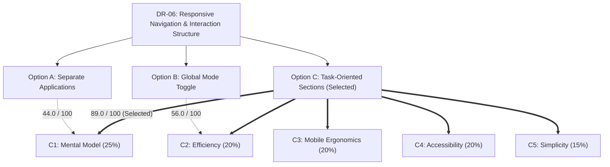

# Design Decision DR-06: Responsive Navigation and Borrower/Owner Interaction Structure

## 1. Decision ID and Title
- **ID**: `DR-06`
- **Title**: Responsive Application Navigation and Borrower/Owner Task Architecture

---

## 2. Status
**DECIDED** (Selected Option C: Unified Application with Task-Oriented Sections).

---

## 3. Design Context
In peer-to-peer item sharing, an individual user does not occupy a single static role. On Monday, a resident may borrow a hedge trimmer to tidy their garden; on Tuesday, that same resident may lend their carpet cleaner to a neighbor. The application must support both borrowing and lending workflows seamlessly without forcing awkward logouts, mode toggles, or split personalities.

---

## 4. Design Question
> **How should the application organize borrowing and lending activities so that an individual can comfortably perform both types of tasks on desktop and mobile devices?**

---

## 5. Why the Question Matters
If an application forces users into a global "Mode Switch" (e.g., toggling between *Borrower Mode* and *Lender Mode*), users suffer from mode confusion, hidden notifications, and friction when checking a loan while browsing new items. If the application is split into two disjoint websites, maintenance is doubled and users face severe fragmentation. The navigation architecture must provide a coherent mental model that accommodates dual activities gracefully across desktop and mobile screens.

---

## 6. Requirements Affected
- **FR-001** through **FR-010**: All functional modules operate within this navigation shell.
- **NFR-001**: Usability & Interaction (intuitive switching, clear active indicators)
- **NFR-002**: Accessibility (semantic `<nav>` landmark, `aria-current="page"`, visible focus rings)
- **NFR-003**: Responsiveness & Mobile Ergonomics (touch targets meeting or exceeding 44×44 CSS pixels)

---

## 7. Relevant Usability and HCI Principles
- **Nielsen Heuristic #4 (Consistency and Standards)**: Navigation labels must remain constant across all views and platforms.
- **Nielsen Heuristic #6 (Recognition Rather than Recall)**: Key functional destinations must be visible at all times rather than hidden inside deep nested hamburger menus.
- **Nielsen Heuristic #7 (Flexibility and Efficiency of Use)**: Users can pivot from viewing an incoming borrowing request to discovering new items in a single click.
- **WCAG 2.2 SC 2.5.8 (Target Size Minimum - Level AA, 24×24px)** & **SC 2.5.5 (Target Size Enhanced - Level AAA, 44×44px)**: BorrowNest adopts a strict **44×44 CSS pixel** touch target baseline on mobile navigation to ensure effortless mobile ergonomics.

---

## 8. Alternatives Considered

### Option A: Separate Borrower and Owner Applications
- Two distinct web applications or sub-domains (e.g., `borrow.borrownest.local` and `lend.borrownest.local`).
- Completely separated codebases or routing trees.

### Option B: Single Application with Global Mode Toggle
- A single application with a global header switch: `[Borrower Mode | Lender Mode]`.
- Toggling the switch reconfigures the entire interface; only one mode is active at any time.

### Option C: Unified Application with Task-Oriented Sections
- A single, cohesive application organized into four top-level task destinations:
  1. **Discover**: Browse, search, and inspect available items.
  2. **Borrowing**: Manage outgoing borrowing requests, active loans, and return schedules.
  3. **Lending**: Manage owned item listings, incoming approval requests, and items lent out.
  4. **Account**: Local data backup/export, privacy policies, and client preferences.
- **Responsive Presentation**:
  - *Desktop*: Integrated horizontal top navigation bar.
  - *Mobile*: Fixed bottom navigation bar with distinct icons, clear text labels, and 44×44 CSS pixel touch targets.

---

## 9. Detailed Strengths and Weaknesses

| Option | Strengths | Weaknesses |
| :--- | :--- | :--- |
| **Option A: Separate Applications** | • Maximizes isolation between tasks.<br>• Simpler individual view logic. | • Fragmented user experience.<br>• Dual deployment, configuration, and state synchronization overhead.<br>• Unnatural for peers who borrow and lend concurrently. |
| **Option B: Global Mode Toggle** | • Single deployment.<br>• Familiar from gig-economy apps (e.g., driver vs. passenger). | • High mode confusion: users forget which mode is active.<br>• Hides notifications for one role while the other is active.<br>• Extra cognitive overhead to flip a switch just to check an item. |
| **Option C: Task-Oriented Sections** | • Intuitive, mode-free conceptual model.<br>• Single-click switching between borrowing and lending.<br>• Cohesive notification badges across both activities.<br>• Accessible, standard responsive mobile ergonomics. | • Requires responsive CSS rules to transition between top bar (desktop) and bottom bar (mobile). |

---

## 10. Evaluation Criteria and Weights

| ID | Criterion | Weight | Justification |
| :--- | :--- | :---: | :--- |
| **C1** | **Mental Model and Task Clarity** | 25% | Users must intuitively understand where to go without guessing their active "role" or mode. |
| **C2** | **Efficiency When Changing Activities** | 20% | Transitioning between borrowing and lending tasks should take no more than a single interaction. |
| **C3** | **Responsive & Mobile Ergonomics** | 20% | Navigation must be effortless on small touchscreens (320px+) with ample target sizes. |
| **C4** | **Accessibility and Consistency** | 20% | Screen readers and keyboard users must have predictable landmark navigation and live state announcements. |
| **C5** | **Implementation Simplicity** | 15% | The routing and navigation hierarchy should remain clean, maintainable, and lightweight. |
| **Total** | | **100%** | |

---

## 11. Evaluation Matrix

| Criterion | Weight | Option A: Separate Apps | Option B: Mode Toggle | Option C: Task Sections |
| :--- | :---: | :---: | :---: | :---: |
| **C1: Mental Model** | 25% | 2 / 5 | 3 / 5 | 5 / 5 |
| **C2: Efficiency** | 20% | 1 / 5 | 2 / 5 | 5 / 5 |
| **C3: Mobile Ergonomics** | 20% | 3 / 5 | 3 / 5 | 4 / 5 |
| **C4: Accessibility** | 20% | 3 / 5 | 3 / 5 | 4 / 5 |
| **C5: Simplicity** | 15% | 2 / 5 | 3 / 5 | 4 / 5 |

---

## 12. Weighted Calculations

### Formula:
$$\text{Score} = \sum_{i=1}^{5} \left( W_i \times \frac{R_i}{5} \right)$$

- **Option A (Separate Applications)**:
  $$\text{Score}_A = (25 \times 0.4) + (20 \times 0.2) + (20 \times 0.6) + (20 \times 0.6) + (15 \times 0.4)$$
  $$\text{Score}_A = 10.0 + 4.0 + 12.0 + 12.0 + 6.0 = \mathbf{44.0}$$

- **Option B (Global Mode Toggle)**:
  $$\text{Score}_B = (25 \times 0.6) + (20 \times 0.4) + (20 \times 0.6) + (20 \times 0.6) + (15 \times 0.6)$$
  $$\text{Score}_B = 15.0 + 8.0 + 12.0 + 12.0 + 9.0 = \mathbf{56.0}$$

- **Option C (Task-Oriented Sections)**:
  $$\text{Score}_C = (25 \times 1.0) + (20 \times 1.0) + (20 \times 0.8) + (20 \times 0.8) + (15 \times 0.8)$$
  $$\text{Score}_C = 25.0 + 20.0 + 16.0 + 16.0 + 12.0 = \mathbf{89.0}$$

---

## 13. Rating Justifications
- **C1 (Mental Model)**: Option C scores 5/5 because "Discover", "Borrowing", and "Lending" map directly to real-world tasks. Option A scores 2/5 (fragmented). Option B scores 3/5 (artificial role dichotomy).
- **C2 (Efficiency)**: Option C scores 5/5 (1-click direct navigation). Option B scores 2/5 (requires toggling mode, waiting for UI repaint, then finding section). Option A scores 1/5.
- **C3 (Mobile Ergonomics)**: Option C scores 4/5 by pairing a fixed bottom navigation bar with 44×44px touch targets. Options A and B score 3/5 due to cluttered mobile headers.
- **C4 (Accessibility)**: Option C scores 4/5 using semantic `<nav>`, `aria-current="page"`, and visible focus indicators. Options A and B score 3/5.
- **C5 (Implementation Simplicity)**: Option C scores 4/5 (single clean view router). Option B scores 3/5. Option A scores 2/5 (dual builds).

---

## 14. Selected Option
**Option C: Unified Application with Task-Oriented Sections**.

---

## 15. Selection Rationale
Option C achieves a commanding score of **89.0 / 100**, far surpassing Option B (56.0) and Option A (44.0). Option C eliminates mode confusion, reflects the real-world fluidity of community lending, and provides superior mobile ergonomics through dedicated touch-friendly bottom navigation.

---

## 16. Architectural Role Distinction
> [!IMPORTANT]
> **Task Perspectives, Not Security Roles**: In the current local-first prototype, **Borrower** and **Lender** represent *functional task perspectives*, not authenticated server-side access control roles. An individual user interacts with both perspectives within a single local application state.

---

## 17. Responsive Navigation Wireframe Model

```text
DESKTOP (Screen width >= 768px):
+------------------------------------------------------------------------+
| [Logo] BorrowNest    [Discover]   [Borrowing]   [Lending]    [Account] |
+------------------------------------------------------------------------+
| MAIN CONTENT AREA                                                      |
|                                                                        |
+------------------------------------------------------------------------+

MOBILE (Screen width < 768px):
+------------------------------------------------------------------------+
| [Logo] BorrowNest                                        [Status Pill] |
+------------------------------------------------------------------------+
| MAIN CONTENT AREA (Padded bottom to prevent navigation overlap)        |
|                                                                        |
+------------------------------------------------------------------------+
|   [Discover]       [Borrowing]        [Lending]          [Account]     |
|   (Min 44x44px)   (Min 44x44px)     (Min 44x44px)      (Min 44x44px)   |
+------------------------------------------------------------------------+
```

---

## 18. Consequences for Future Implementation
- **Future UI Shell**: Implement `<nav role="navigation" aria-label="Main Navigation">` with tabs:
  - `Discover`: Catalog grid, search, filters.
  - `Borrowing`: Active outgoing loans, return alerts.
  - `Lending`: Owned items list, add listing button, incoming request approvals.
  - `Account`: Storage export/import, genuine data notice, documentation links.

---

## 19. Evidence References
- **E-01 (QOC)**: MacLean et al. (1991), evaluating architectural structures against ergonomics.
- **E-02 (NN/g Heuristics)**: Heuristic #4 (Consistency), Heuristic #6 (Recognition over Recall), Heuristic #7 (Flexibility & Efficiency).
- **E-03 (WCAG 2.2)**: SC 2.5.8 (Target Size Minimum - Level AA: 24×24px) and SC 2.5.5 (Target Size Enhanced - Level AAA: 44×44px, adopted as BorrowNest internal design target).

---

## 20. Mermaid QOC Diagram



---

## 21. Final Decision Statement
BorrowNest adopts **Option C (Unified Application with Task-Oriented Sections)**. The application will organize functionality into four explicit task sections (*Discover*, *Borrowing*, *Lending*, *Account*), accessible via a sticky desktop header and a fixed mobile bottom navigation bar with minimum 44×44 CSS pixel touch targets.
