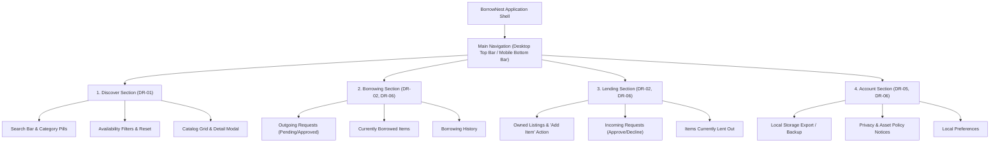
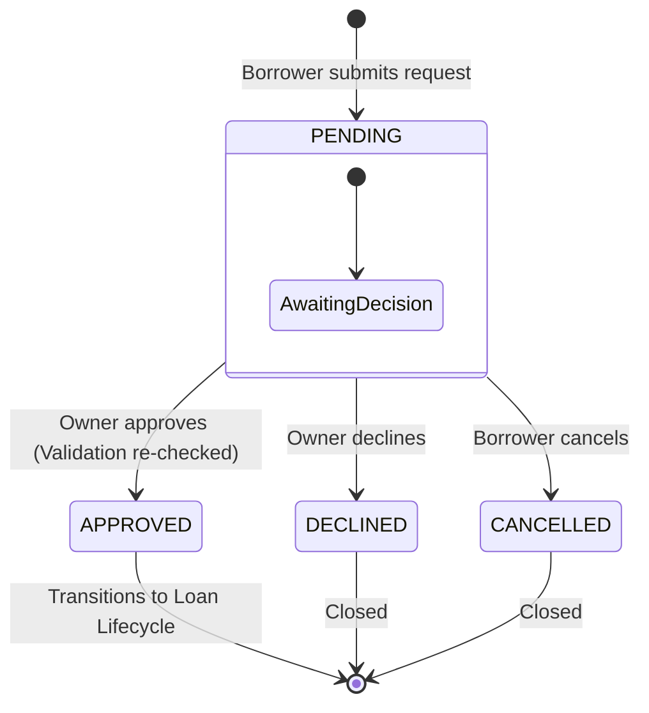
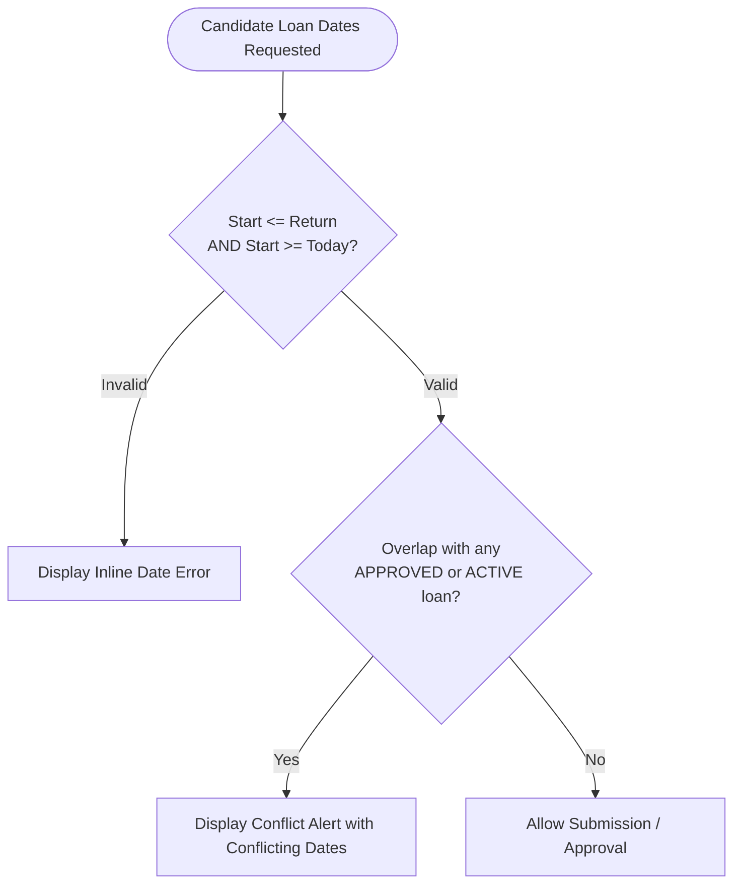
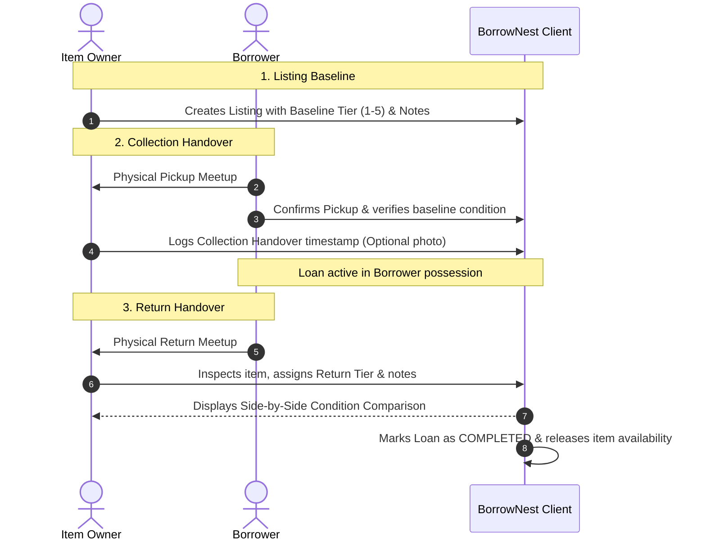
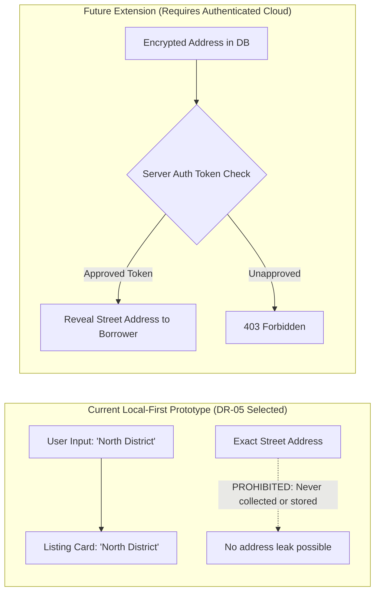
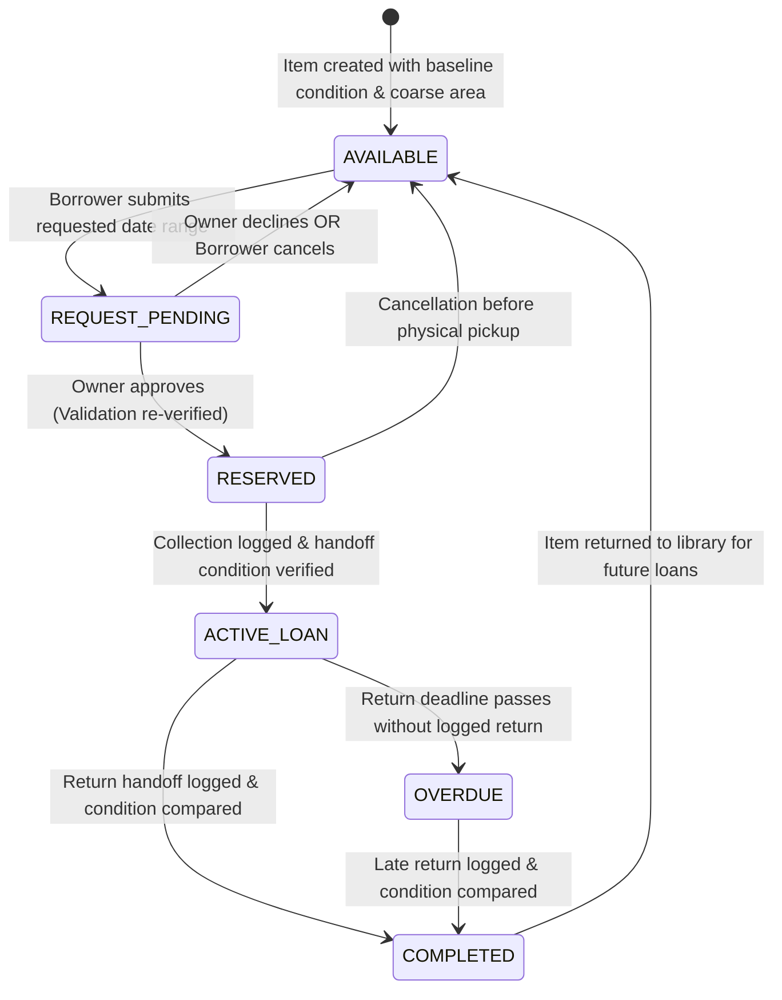

# BorrowNest — Selected Design Blueprint

This document synthesizes the six resolved Question-Option-Criteria (QOC) decisions into one unified, cohesive product architecture specification. It serves as the master technical and interaction blueprint for future implementation modules (Modules 03 through 06).

---

## 1. Information Architecture and Application Shell

BorrowNest operates as a unified, single-page application structured into four dedicated, task-oriented sections:

---

## 2. Subsystem Specifications

### A. Discovery and Search Subsystem (DR-01)
- **Search Interaction**: Persistent accessible search field with explicit `<label>` and dynamic live filtering.
- **Categorical Navigation**: Filter pills across standard categories: *All*, *Tools*, *Gardening*, *Household*, *Outdoor*, *Electronics*.
- **Availability Toggle**: Checkbox filter to isolate items currently free for borrowing.
- **Feedback & Reset**: Dynamic matching count (`aria-live="polite"`) and a visible "Reset All Filters" chip when filters are active.
- **Empty State**: Clear zero-results state guiding the user to broaden their search terms.

### B. Borrowing Request and Approval Subsystem (DR-02)
- **Request Data Payload**: Selected item ID, borrower alias, collection date, return deadline, and optional note.
- **Owner Review Flow**: Incoming requests appear in the *Lending* section with explicit, unbundled **Approve** and **Decline** buttons.
- **Borrower Control**: The requester may unilaterally **Cancel** a pending request before the owner acts on it.
- **State Invariants**: A closed request (`APPROVED`, `DECLINED`, `CANCELLED`) is immutable and cannot be re-opened.

### C. Availability and Scheduling Subsystem (DR-03)
- **Date Inputs**: Standard HTML5 date pickers (`<input type="date">`) for Collection Date and Return Deadline.
- **Inclusive Range Overlap Rule**: Two intervals overlap if and only if:
  $$\text{candidateStart} \le \text{existingReturn} \quad \text{AND} \quad \text{existingStart} \le \text{candidateReturn}$$
- **Non-Blocking Pending Rule**: Multiple pending requests can overlap; only approved or active loans lock the calendar.
- **Race Condition Prevention**: Re-running overlap validation at the exact moment of approval prevents double-booking.

### D. Item Condition and Handover Subsystem (DR-04)
- **Standard 5-Tier Condition Scale**: `5: Like New`, `4: Good`, `3: Fair`, `2: Poor`, `1: Not Functional`.
- **Three Lifecycle Checkpoints**:
  1. *Listing Baseline*: Owner logs initial tier and known cosmetic defects.
  2. *Collection Handoff*: Borrower and owner verify condition at pickup; optional genuine photo upload.
  3. *Return Handoff*: Owner verifies condition upon return, logs closing tier and remarks.
- **Comparative Review**: Side-by-side card displaying baseline condition vs. return condition.
- **Image Integrity Pipeline**: Client-side canvas resizing, EXIF GPS coordinate stripping, local WebP/JPEG data storage.

### E. Spatial Privacy and Security Boundary (DR-05)
- **Coarse Locality**: Listings collect and display only general neighborhood, suburb, or landmark areas (e.g., "Oakwood / Near Central Station").
- **Zero Address Harvesting**: Exact residential street addresses, apartment unit numbers, and private lockbox codes are **not** collected or stored in the local-first prototype.
- **Security Boundary**: Recognizes that client-side UI toggles are not cryptographic access controls; what is never stored cannot be breached.

### F. Responsive Navigation Subsystem (DR-06)
- **Unified Navigation Shell**: Desktop sticky top header; mobile fixed bottom bar.
- **Touch Target Ergonomics**: All interactive mobile buttons and tabs have a minimum hit area of **44 × 44 CSS pixels** (surpassing WCAG 2.2 Level AA SC 2.5.8 24×24px and satisfying Level AAA SC 2.5.5 as an intentional internal project target).
- **Landmarks & a11y**: `<nav role="navigation" aria-label="Main Navigation">`, `aria-current="page"`, high contrast ratios (4.5:1+), visible focus rings (`:focus-visible`).

---

## 3. Comprehensive Loan Lifecycle State Machine

---

## 4. Blueprint Implementation Status

| Architecture Area | Blueprint Components | Implementation Status |
| :--- | :--- | :--- |
| **Responsive Shell (DR-06)** | Desktop sticky header, mobile bottom nav with 48px touch targets, hash router (`#discover`, `#borrowing`, `#lending`, `#account`) | **Implemented & Verified (Module 03)** |
| **Item Management (DR-04, DR-05)** | Lending workspace, item creation/edit forms, availability toggle, archive/restore, delete confirmation, native IndexedDB persistence | **Implemented & Verified (Module 03)** |
| **Media Pipeline (DR-04)** | Canvas EXIF/GPS metadata stripping, 1600px scaling, WebP/JPEG compression, mandatory alt text | **Implemented & Verified (Module 03)** |
| **Account & Data Portability** | JSON backup export (`borrownest-backup` v1), schema-validated merge and replace restore, storage diagnostics | **Implemented & Verified (Module 03)** |
| **Item Discovery & Catalog (DR-01)** | Keyword search, categorical exploration pills, availability toggling, catalog grid, read-only item cards, detail modal, honest zero states | **Implemented & Verified (Module 04)** |
| **Borrowing Requests & Approval (DR-02)** | Direct request dialog (`BorrowRequestDialog`), owner review workflow in Lending, cancellation handling, immutable terminal states | **Implemented & Verified (Module 05)** |
| **Availability Scheduling (DR-03)** | HTML5 date pickers, inclusive overlap collision prevention, atomic approval transaction, active reservation schedule overview | **Implemented & Verified (Module 05)** |
| **Condition Handover (DR-04)** | Physical handover dialog (`CollectionHandoverDialog`), receipt confirmation, return inspection dialog (`ReturnInspectionDialog`), side-by-side condition comparison (`ConditionComparisonView`), uncollected reservation release (`ReleaseUncollectedDialog`), IndexedDB Schema v3, and Backup v3 | **Implemented & Verified (Module 06)** |
